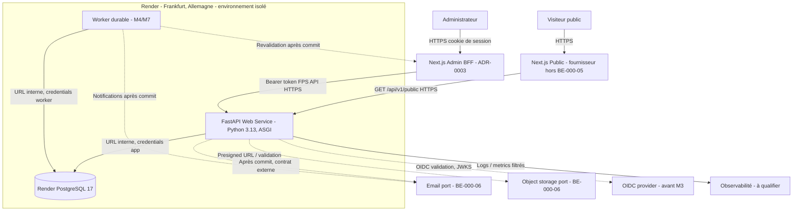
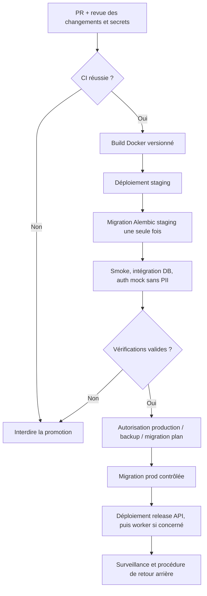

# M0 - Topologie d'exécution et responsabilités (BE-000-05)

**Statut : ACCEPTED_DESIGN / NOT PROVISIONED**  
**Date : 2026-11-25**  
**ADR autoritaire : `docs/adr/ADR-0005-infrastructure-providers.md`**  
**Scope : préparation M1/M2 et contraintes de qualification, pas de configuration active.**

## 1. Schéma cible

**Attention** : les traits pointillés sont des ports/intégrations **cibles**, pas des appels réellement déployés. Le worker n'existe pas pendant M0.

## 2. Environnements

| Surface | local | staging | production |
|---|---|---|---|
| Backend API | Docker/ASGI local M1 | Render web Frankfurt M1/M2 | Render web Frankfurt, après gate |
| PostgreSQL | PostgreSQL local dédié | Render PG 17 isolé M2 | Render PG 17 isolé, payant/PITR |
| Worker outbox | process local contrôlé M4 | worker dédié sur Render M4 | worker Render dédié + retry M4/M7 |
| Next.js | dépôt/frontend séparé | environnement staging séparé | environnement public/prod séparé |
| Secrets | `.env` non versionné | env secret de staging uniquement | env secret de prod uniquement |
| Test data | synthétique | synthétique / anonymisé | données métier autorisées |
| OpenAPI | artefact contractuel M1 | vérifier compatibilité | contrat versionné |

Séparation stricte de DB, credentials et endpoints. Aucun fork de staging ne doit être implicitement alimenté par une copie de PII de production.

## 3. Boundary des données et du réseau

1. Le navigateur n'accède **jamais directement à PostgreSQL**.
2. Next.js ne possède ni le rôle DB, ni les règles métier; le BFF passe un access token destiné à l'API (ADR-0003).
3. Le backend exige une connexion DB authentifiée et à privilèges minimaux, par lien **interne Render de même région** pour le runtime.
4. Les accès externes temporaires depuis CI/dev nécessitent **TLS**, restrictions d'accès et DB de qualification distincte; pas d'ouverture universelle des IP de prod.
5. Les secrets SMTP/stockage/OIDC ne sont pas des variables `NEXT_PUBLIC_*`.
6. Les binaires Media restent en object storage, tandis que leurs références et leurs métadonnées vivent dans PostgreSQL.
7. Les logs, métriques et traces techniques doivent masquer tokens et PII; aucun contenu intégral de demande Contact dans les traces.
8. Les journaux et traitements tiers ne sont pas réputés hébergés dans l'UE simplement parce que la DB est à Francfort.

## 4. Stratégie de connexions pour SQLAlchemy sync

**Source : ADR-0002; paramétrage concret à tester en M2.**

- `POSTGRES_MAJOR=17` comme cible, non comme version réellement installée.
- `DATABASE_URL` = URL interne DB pour API/worker sur Render.
- `DATABASE_DIRECT_URL` réservée à un job migration/maintenance, jamais exposée dans le frontend.
- `pool_size`, `max_overflow`, `pool_timeout`, `pool_recycle` et nombre de workers à calibrer en test.
- Relation de dimensionnement : `total_connections <= instances_api * (pool_size + max_overflow) + instances_worker * (pool_size + max_overflow) + migration_connections + reserve`, avec réserve sous la limite effective du plan. Ne jamais coller des nombres arbitraires dans un `render.yaml` non testé.
- Si PgBouncer activé : transaction pooling à qualifier, et migrations Alembic uniquement en connexion directe.
- Session SQLAlchemy par Unit of Work; pas de Session partagée entre requêtes; fermeture garantie.

## 5. Release et migration M1/M2

Ce diagramme est **une procédure cible**. Aucune CI, image Docker, migration ou release n'est déclarée existante. Migrations destructives nécessitent un plan roll-forward/backup : un rollback de code seul ne restaure pas le schéma/données.

## 6. Sauvegarde et restauration

**Avant données réelles (gate obligatoire)**
- Choisir une offre DB payante avec PITR effectif et documenter sa fenêtre contractuelle.
- Tester une restauration PITR dans **une nouvelle instance isolée**; jamais écraser le seul exemplaire des données.
- Vérifier comptages, contraintes, versions Alembic, exemples de ressources publiées et Contacts sans exposer la PII.
- Archiver le compte rendu horodaté : commandement/exécution, RPO/RTO constatés, anomalies, décision de cutover.
- Documenter le coût et la rétention d'exports indépendants de PITR, avec accès limité.
- Verrouiller les migrations destructives tant que le runbook et le restore ne sont pas vérifiés.

**État M0 : PLANNED / NO RESTORE RUN.**

## 7. Checklist de préparation de la configuration M1

- [x] Dépôt backend autonome validé (ADR-0001).
- [x] Python 3.13 / sessions SQLAlchemy sync / psycopg3 validés pour design (ADR-0002).
- [x] Infrastructure cible API/DB/worker et région choisies pour design (ADR-0005).
- [x] Frontières, secrets et environnements définis.
- [ ] Dépendances installables sous Python 3.13 : preuve toujours manquante depuis BE-000-03.
- [ ] Construire Dockerfile et `pyproject.toml`, puis `uv.lock` en M1.
- [ ] Créer CI lint, typage, tests, scans secrets et image smoke en M1.
- [ ] Créer ou rattacher un workspace Render après contrôle des permissions et budget.
- [ ] Vérifier devis et disponibilité des plans (PITR) pour staging/prod.
- [ ] Provisionner PostgreSQL 17 à Francfort en M2 et vérifier la connexion.
- [ ] Tester système de migrations et rétention, backups/PITR avant données réelles.

## 8. Plan de validation par jalon

| Référence | Test attendu | Jalon | Statut actuel |
|---|---|---|---|
| INF-TEST-01 | Image Python 3.13 / import FastAPI/SQLAlchemy/psycopg | M1 | MISSING |
| INF-TEST-02 | `GET /health/live` et arrêt gracieux | M1 | MISSING |
| INF-TEST-03 | PostgreSQL 17, connexion, commit/rollback depuis app | M2 | MISSING |
| INF-TEST-04 | Alembic upgrade + rollback sous stratégie contrôlée | M2 | MISSING |
| INF-TEST-05 | Pool sous concurrence / limite fournisseur | M2 / M11 | MISSING |
| INF-TEST-06 | Isolation de staging/prod, absence de credentials prod en staging | Avant prod | MISSING |
| INF-TEST-07 | Connexion DB par private network de même région | Staging | MISSING |
| INF-TEST-08 | TLS sur toute connexion externe autorisée | Avant exposition | MISSING |
| INF-TEST-09 | PITR, restauration isolée, contrôle d'intégrité | Avant données réelles | MISSING |
| INF-TEST-10 | Worker outbox, retry après redémarrage | M4 / M7 | MISSING |
| INF-TEST-11 | Aucune donnée Contact dans les logs d'infra | M4 / M11 | MISSING |
| INF-TEST-12 | Coût mensuel observé et budget alerting | Staging / prod | MISSING |

## 9. Dossier de responsabilité

| Domaine | Responsable de conception | Responsable d'exploitation |
|---|---|---|
| Backend / image | Pilote technique FPS | Pilote technique FPS (à déléguer) |
| PostgreSQL / migrations | Pilote technique FPS | Pilote technique FPS + fournisseur selon SLA |
| Backups/PITR / restore | Pilote technique FPS | Pilote technique FPS, Render opère le service |
| Secrets / IAM technique | Pilote technique FPS | Pilote technique FPS + owner sécurité |
| Protection des PII / conformité | Référent FPS à nommer | Référent Privacy/juridique FPS à désigner |
| Budget / abonnements | Porteur du projet | Porteur du projet |
| Frontend Next.js | Owner frontend à désigner | Owner frontend à désigner |
| Email/media | BE-000-06 | Owner intégrations à attribuer |

Ces rôles constituent des **responsabilités à attribuer**, pas des identités de personnes recrutées ou des engagements contractuels existants.

## 10. References fournisseur

- https://render.com/docs/regions
- https://render.com/docs/private-network
- https://render.com/docs/postgresql-backups
- https://render.com/docs/postgresql-connection-pooling
- https://render.com/docs/background-workers
- https://render.com/docs/blueprint-spec
- https://render.com/pricing

**Conclusion : topologie exécutable sur le plan architectural, non déployée. Le Gate M0 global reste ouvert.**
