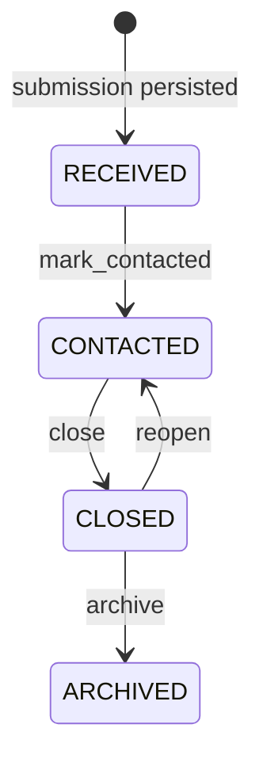
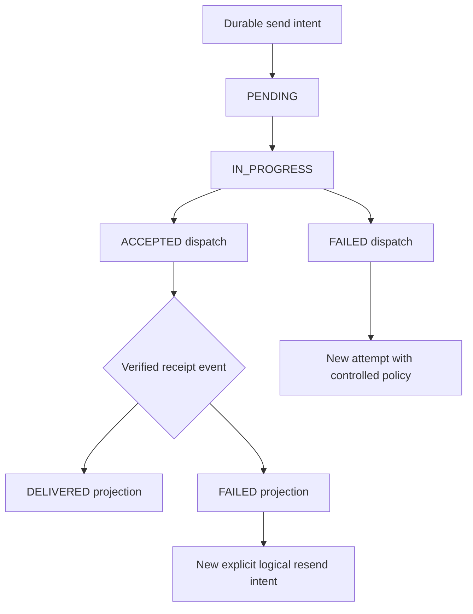
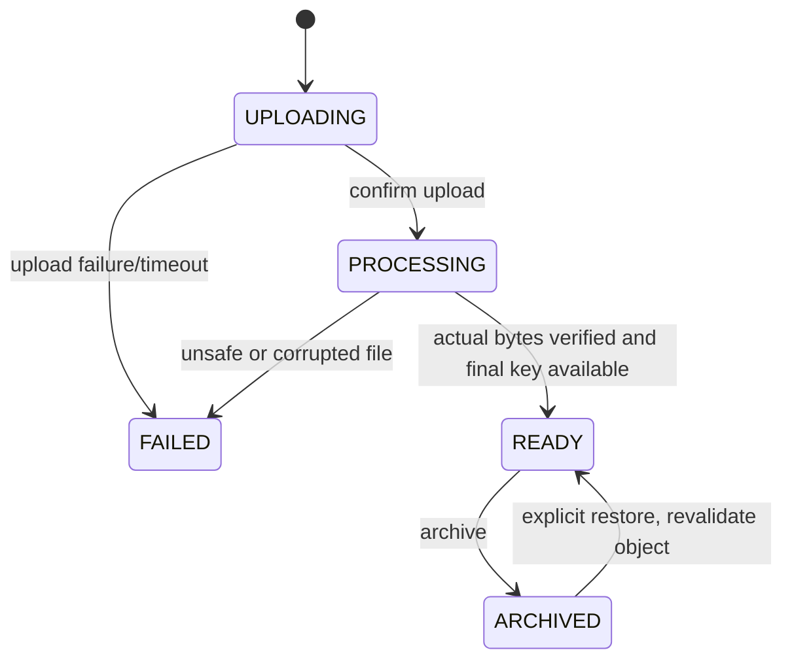

# BE-000-08 - Domain State Crosswalk

| Champ | Valeur |
|---|---|
| Milestone/ticket | M0-T3 / BE-000-08 (P0) |
| Date | 2026-11-25 |
| Etat | ACCEPTED_DESIGN / NO_CODE |
| Decision | ADR-0007-domain-state-and-revisions.md |
| Owner/reviewer | Pilote technique FPS, validation deleguee explicitement par le porteur le 2026-11-25 |
| Sources | 07, 10, 11, 12, 13, 14, 15, 18, 21 et les contrats API v1 du depot |
| Principe | Les sources comportent des etats candidats divergents. Les lignes suivantes constituent des choix explicites, pas un consensus historique invente. |

## 1. Tableau contractuel des huit ecarts

Les colonnes demandées par M0 sont `concept`, `sources`, `discrepancy`, `chosen rule`, `affected endpoints`, `affected tables`, `tests`, `decision_ref` et `reviewer`.

| concept | sources | discrepancy | chosen rule | affected endpoints | affected tables | tests | decision_ref | reviewer |
|---|---|---|---|---|---|---|---|---|
| ST-01 Publication | 07:21-28, 11:5-10, 18:28-31 | Full workflow vs MVP minimal | MVP DRAFT/PUBLISHED/ARCHIVED; explicit Publish/Archive/Restore; republish creates snapshot | admin pages publish/archive/restore, blog equivalents, public GET | pages, blog_posts, revisions | ST-001..008 | ADR-0007/ST-01 | Pilote technique FPS |
| ST-02 Contact | 07:64-75, 13:24-43/117, 18:56-59, ADR-0006 | ContactStatus conflates delivery and business, SUCCEEDED conflates acceptance and delivery | workflow_status RECEIVED/CONTACTED/CLOSED/ARCHIVED; dispatch PENDING/IN_PROGRESS/ACCEPTED/FAILED; receipt event append-only; projected delivery_status separate | POST /api/v1/contact, GET admin contacts, delivery retry, close/reopen | contact_submissions, contact_deliveries, receipt events/outbox TBD BE-000-09 | ST-009..020 | ADR-0007/ST-02 | Pilote technique FPS |
| ST-03 Working/public | 11:37-43/88-92, 18:28-47 | Mutable current row vs published_revision_id | Public reads immutable revision of same resource, iff PUBLISHED; working edit never leaks | public pages/blog, admin preview/publish | pages, blog_posts, page_revisions, blog_post_revisions | ST-021..028 | ADR-0007/ST-03 | Pilote technique FPS |
| ST-04 Locale/slug | 07:INV-PAGE-001-004, 12:15-23/66-72, 18:32-34/50 | Global vs type-specific uniqueness, different localized slugs | UNIQUE(locale,slug) per type, UNIQUE(translation_group_id,locale) per type, URL namespaces distinct, reserved paths checked | public pages/{locale}/{slug}, blog/{locale}/{slug}, translations | pages, blog_posts, redirects future | ST-029..035 | ADR-0007/ST-04 | Pilote technique FPS |
| ST-05 Media | 07:INV-PAGE-009/INV-MEDIA-001-007, 14:32-39/75-77, ADR-0006 | PENDING_UPLOAD vs canonical status; READY and localized alt timing | MediaStatus UPLOADING/PROCESSING/READY/FAILED/ARCHIVED; PENDING_UPLOAD belongs to upload intent; verify binary before READY; alt at Publish unless decorative explicit | admin media upload-intents/confirm, publish, media archive | media_assets, upload_intents future, content_blocks | ST-036..046 | ADR-0007/ST-05 | Pilote technique FPS |
| ST-06 Revisions | 07:26-28, 11:37-43, 18:43-47 | Snapshot every edit vs selected lifecycle transitions | INSERT-only revisions on Publish, Archive, Restore, optional Manual; no ordinary save snapshot; pointer only publish-approved snapshot | admin PATCH/publish/archive/restore/revisions | pages, page_revisions, blog_posts, blog_post_revisions | ST-047..054 | ADR-0007/ST-06 | Pilote technique FPS |
| ST-07 Navigation/taxonomy | 12:15-23/96-99, 18:51-54/73-76, 14:70-78 | JSONB vs relational, locales as columns | Navigations relational per locale, taxonomy code unique + labels JSONB, API category/tag slug=code in v1, media alt/caption JSONB | public navigation, blog categories/tags, admin content | navigations, navigation_items, categories, tags, media_assets | ST-055..063 | ADR-0007/ST-07 | Pilote technique FPS |
| ST-08 IAM | 07:90-107, 15:17-24/55-61/88-95, ADR-0003 | IdP session vs local UserStatus and permissions, MEDIA_UPLOAD alias | ACTIVE/SUSPENDED/DISABLED only; validate issuer+sub, User ACTIVE, local RBAC; MANAGE_MEDIA for upload, atomic last SuperAdmin guard | all admin routes, users/roles, media upload | users, roles, user_roles, external identity mapping | ST-064..074 | ADR-0007/ST-08 | Pilote technique FPS |

## 2. Transitions Content (Page et BlogPost)

| From | Command | To | Validation | Public |
|---|---|---|---|---|
| none | Create | DRAFT | locale, slug reserve/unique, CREATE_CONTENT | 404 |
| DRAFT | Publish | PUBLISHED | PUBLISH_CONTENT, version, blocks, SEO, media READY, alt | new immutable revision |
| PUBLISHED | Edit working | PUBLISHED | EDIT_CONTENT + expected_version | unchanged prior revision |
| PUBLISHED | Republish | PUBLISHED | PUBLISH_CONTENT + version/validators | new immutable revision |
| PUBLISHED | Archive | ARCHIVED | ARCHIVE_CONTENT, audit | 404 |
| ARCHIVED | Restore | DRAFT | RESTORE_CONTENT, audit | 404 until Publish |
| ARCHIVED | Publish directly | FORBIDDEN | requires Restore first | 404 |
| DRAFT | Submit for review | DEFERRED | full workflow phase 2 | unchanged |

- There is no implicit re-publication on PATCH. `published_revision_id` points to a revision belonging to the same resource.
- Publish transaction includes immutable snapshot, version/pointer/status and audit/outbox intent. External Next.js revalidation is after commit (BE-000-09).
- No public fallback to working copy on missing or invalid pointer.
- Every historic revision has unique (resource_id, version_number); archive/restore snapshot, if created, is NOT repointed as public revision automatically.

## 3. Contact : progression commerciale et transport distincts

### Business state

`NEW` becomes an optional inbox read marker, NOT business status. There is no `DELIVERING`, `DELIVERED` or `DELIVERY_FAILED` in business workflow. MarkContacted can happen while an Email is pending or failed. After CLOSED, reopening requires an explicit command; after ARCHIVED, restoration is outside MVP until a separate decision. Public POST Contact returns 201 `RECEIVED` **only after DB commit**.

### Delivery state, attempts and receipts

- Each ContactDelivery attempt is traceable, numbered per channel and logical intent; never erase history.
- ACCEPTED means provider accepted transport, same semantics as `SUCCEEDED` of EmailDeliveryPort. It does **not** mean DELIVERED.
- Signed, deduplicated webhook events report DELIVERED or BOUNCED separately. An accepted attempt remains an accepted historical dispatch even when a later bounce changes the **derived** delivery_status.
- Retry due to timeout within the same logical send keeps idempotency key and stable payload; explicit resend after a known bounce makes a new logical send intent and key.
- Exact outbox and event tables, retry leases and provider timeout reconciliation are **BE-000-09**, not simulated as implemented here.
- No email provider failure deletes ContactSubmission or changes workflow_status.

## 4. Media transitions and publication guard

`PENDING_UPLOAD` is upload-intent status, not canonical MediaStatus. `REJECTED` is a validation result, not canonical MediaStatus. No direct FAILED -> READY overwrite. For **new** published references only READY media are eligible. Existing published snapshots may retain a reference to ARCHIVED media until replacement/retention action; hard deletion requires a reference check. At Publish, every **non-decorative** image must have a verified localized alt in that page's locale. `decorative=true` is explicit on the block; empty alt alone does not imply decorative.

## 5. Translation and slugs

- Page FR and Page EN are **two records** sharing translation_group_id, each with independent locale, slug, revisions and publish state.
- Unique (translation_group_id, locale) per resource type. Cross-type group mixing prohibited.
- Unavailable EN resource is public 404 under /en/*; never silently substitute French. Hreflang only includes actually published translations.
- `translation_status` is a **derived admin projection**: MISSING, DRAFT, PUBLISHED, OUTDATED, ARCHIVED. OUTDATED is freshness information, not a persisted replacement for publication_status. A published translation may be OUTDATED yet remain published until explicit editorial action.
- Only mark OUTDATED when translated_from_revision_id (candidate) and a source revision provide evidence; otherwise show unknown freshness rather than fabricated status.
- Pages: unique (locale, slug) in pages, BlogPosts: unique (locale, slug) in blog_posts. Keep /{locale}/blog/* separate from /{locale}/{page_slug}; reserved segments (blog, admin, api and actual frontend routes) cannot be used as page slugs.
- Change of published slug requires explicit redirect decision, no unintended cross-locale redirect.

## 6. Menus, categories, tags

- `navigations` / `navigation_items` relational, UNIQUE(code,locale), parent tree acyclic, only published/authorized public target links.
- `categories` / `tags` contain stable unique `code` and localized `labels JSONB`. Public taxonomic `slug` in v1 is the canonical code; localized slugs are not promised until a separate ADR.
- Media `alt_texts JSONB` and `captions JSONB` keyed by locale. No per-language database columns or extra localization table for MVP.

## 7. Identity, roles and permissions

- `UserStatus` canonical ACTIVE, SUSPENDED, DISABLED. INVITED/PROVISIONED are future options, not MVP persisted states.
- API Admin requires verified issuer+subject, ACTIVE in FPS DB and local permission on each call; valid BFF cookie or provider access token alone is insufficient.
- Source 15 has VIEW_MEDIA, MANAGE_MEDIA, DELETE_MEDIA: **MANAGE_MEDIA** for media upload. `MEDIA_UPLOAD` seen in ADR-0006 is a non-canonical illustrative name, not a new role permission.
- Cannot remove the final ACTIVE SuperAdmin or deactivate that account even if concurrent requests race. Transaction with locks/serializable check required, test in M3.
- Permission checks from BFF may help UX, but backend enforces all role restrictions and domain invariants.

## 8. Five critical use cases - no semantic BLOCKING open

| Use case | Domain gate decided | Remaining proof |
|---|---|---|
| PublishPage | Valid working state/locale/blocks/SEO, READY media, alt/decorative, PUBLISH_CONTENT, expected_version, immutable revision/public pointer | M2/M6 and BE-000-09 |
| SubmitContact | Persist RECEIVED + durable delivery intent atomically, workflow separate, idempotency, no network in DB TX | BE-000-09/M4 |
| CreatePageTranslation | New DRAFT resource in same-type translation group, at most one per locale, unique slug, no fallback | M6/M8 |
| MediaReady | Verified actual bytes/MIME/size/checksum/final key, status PROCESSING->READY | M5 |
| AssignRole | ACTIVE admin with MANAGE_ROLES, no escalation and no removal of last ACTIVE SuperAdmin | M3 concurrency |

Error mapping: stale expected_version -> 409 CONCURRENT_MODIFICATION; invalid transition -> 422 VALIDATION_ERROR / domain-specific; unpublished public resource -> 404. This keeps BE-000-07 as the wire contract.

## 9. Schema / contract impact and deferred work

| Artifact | Required follow-up | Stage |
|---|---|---|
| pages, blog_posts and revisions | working fields, publication_status, pointer FK same resource, optimistic locking and immutable revisions | M2/M6 |
| contact_submissions | workflow_status, initial RECEIVED, action timestamps; old generic status is obsolete as conceptual target | M2/M4 |
| contact_deliveries and append-only receipt events | dispatch_state + provider_reference, immutable acceptance evidence; exact event/outbox schema in BE-000-09 | M2/M4 |
| media_assets and upload intents | canonical media status, separate upload-intent status, final object checks, alt JSONB | M5 |
| navigations / categories / tags | relational navigation, unique code per locale, labels JSONB | M6/M8 |
| users / roles / user_roles | local authorization, unique role, last active SuperAdmin lock | M3 |
| admin-api.md and openapi.v1.draft.json | reflect final state/enums and permission mapping after tests | M1/M2/M4 |
| ADR-0006 / integration-ports.md | clarify accepted vs delivered, MANAGE_MEDIA vs MEDIA_UPLOAD, PENDING_UPLOAD intent only | M4/M5 |
| 11, 12, 13, 14, 15, 18 source documents | remain historical reference documents; do not rewrite as if they previously agreed | no source mutation |
| BE-000-09 | durable contact/revalidation replay, provider webhook receipts, anonymous idempotence | M0 next |
| BE-000-11 | schema version ContentBlock JSONB | M0 later |

## 10. Remaining risks

- CONTACT durability and webhook event schema are not selected by BE-000-08; BE-000-09 is P0 and blocks a safe implementation.
- Media READY is a **semantic** rule, not an observed upload.
- Content revisions are a **target** contract, no DB constraints executed yet.
- Contact PII retention period and DPA remain subject to legal/Privacy governance before real data.
- A reviewer role is the delegated pilot; no independent GitHub review is falsely claimed.

**Verdict : ACCEPTED_DESIGN only.** All table/endpoint/test changes remain unimplemented. See `domain-state-test-matrix.md` for planned executable validations.

## Addendum BE-000-09 - Durabilite des projections

La semantique ST-02/03 retenue dans ce fichier est completee (et non remplacee) par `docs/adr/ADR-0004-contact-delivery-durability.md` :

- Une `ContactSubmission(RECEIVED)` n'est validee publiquement qu'apres creation et commit **atomique** de son intent d'envoi et de son event outbox.
- `ContactDelivery.dispatch_status=ACCEPTED` correspond uniquement a l'acceptation par le transport. Les events de reception fournisseur `DELIVERED`/`BOUNCED` sont conserves **append-only** et peuvent arriver avant la correlation provider_ref, auquel cas ils sont persistes pour reconciliation.
- Un `outbox_event` possede son propre etat technique `PENDING/LEASED/RETRY_WAIT/BLOCKED_RECONCILIATION/DEAD/COMPLETED`, **distinct** de workflow_status Contact, de dispatch_status et de publication_status.
- La publication/archivage commit le changement de visibilite et son intent de revalidation avant appel Next.js. Un event `COMPLETED` marque un ACK d'invalidation, pas une garantie que chaque navigateur affiche une page actualisee.
- Les details des tables outbox, reprises, retries et contraintes d'idempotence sont fixes au niveau **conception** par BE-000-09, avec implementation et tests attendus en M2/M4/M7.

## Addendum BE-000-11 - Versions JSONB et état publié (2026-11-25)

Le `content_document_version` d'une Page/BlogRevision et le `block_schema_version` d'un ContentBlock ne sont **pas** `publication_status` ni la version optimistic de Page. Les snapshots immuables de ADR-0007/ST-03/ST-06 conservent les versions historiques telles qu'elles étaient au Publish. Les adaptateurs de lecture upcastent seulement **en mémoire** et doivent maintenir l'équivalence sémantique; une restauration produit une nouvelle working copy, jamais un UPDATE du snapshot ancien. Les BlockTypes sont strictement validés et les versions inconnues ne peuvent pas passer Publish.

Arbitrage de conception : `docs/adr/ADR-0008-content-schema-versioning.md`. Les tests sont dans `content-schema-versioning-test-matrix.md` et restent `NOT_EXECUTED`.
