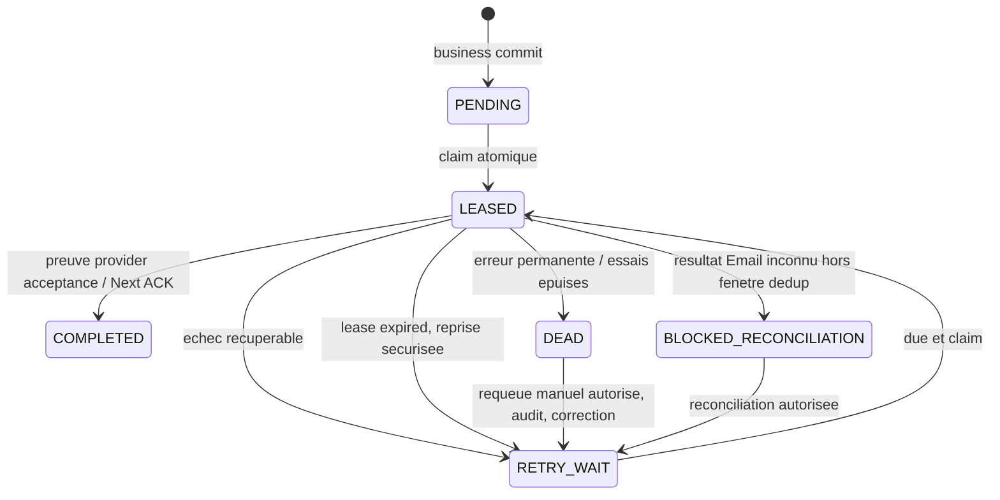

# BE-000-09 - Contrats de durabilite, idempotence, retry et reconciliation

| Champ | Valeur |
|---|---|
| Version | 1.0.0-design |
| Ticket / P | M0 / BE-000-09 / P0 |
| Date | 2026-11-25 |
| Etat | ACCEPTED_DESIGN / NOT_IMPLEMENTED |
| Decision source | `docs/adr/ADR-0004-contact-delivery-durability.md` |
| Dependances | BE-000-03 UoW, BE-000-05 worker Render, BE-000-06 ports, BE-000-07 API, BE-000-08 etats |
| Implementation | M2 schema/outbox; M4 Contact/Email; M7 Publishing/Next.js |
| Gate | Docs verifiees; tests de base/worker/provideur non executes |

**Convention :** les tables, interfaces, commandes SQL, automates et DTO ci-dessous sont des **contrats de conception**, pas des modules Python importables, des migrations creees ou des endpoints operationnels.

## 1. Objectifs mesurables et garanties

| Fait ou effet | Garantie cible | Ne pas promettre |
|---|---|---|
| `POST /api/v1/contact` | La reponse 201 n'arrive qu'apres commit atomique submission+intent+outbox+idempotency+audit assaini | Email delivre, inbox lue, traitement commercial deja fait |
| `PublishPage` / `PublishBlogPost` | Revision immutable + pointeur/etat + audit + intention de revalidation atomiques | Cache Next.js deja rafraichi au moment de la reponse |
| Worker | Au moins une tentative d'effet pour chaque intention admissible et recuperable, sous disponibilite DB/worker | Exactly-once de l'effet externe |
| Resend | Acceptation + reference fournisseur ou echec classifie, dedup dans la fenetre disponible | Livraison finale sans webhook |
| Webhook | Authentifie, deduplique, append-only, etat derivable | Ordre d'arrivee garanti |
| Cache | Revalidation cible rejouable apres panne | Visibilite immediate sur tous CDN/clients |
| Monitoring | Backlog, age, DEAD et incertains visibles | SLA ou RTO avant mesures |

## 2. Operations et ports cibles

```python
# PSEUDOCODE D'INTERFACE. Aucun module implementé pendant M0.
class UnitOfWork(Protocol):
    contacts: ContactRepository
    deliveries: ContactDeliveryRepository
    content: ContentRepository
    outbox: OutboxRepository
    idempotency: IdempotencyRecordRepository
    audit: AuditRepository
    def commit(self) -> None: ...
    def rollback(self) -> None: ...

class DurableOutboxPort(Protocol):
    def enqueue(self, event: OutboxEvent) -> None: ...
    def claim_due(self, *, max_items: int, worker_id: str) -> list[LeasedOutboxEvent]: ...
    def finish(self, *, id: UUID, lease_token: UUID, result: WorkerOutcome) -> bool: ...
    def retry(self, *, id: UUID, lease_token: UUID, available_at: datetime, error_code: str) -> bool: ...
    def block(self, *, id: UUID, lease_token: UUID, reason: str) -> bool: ...

class ContentRevalidationPort(Protocol):
    def revalidate(
        self, *, event_id: UUID, target: RevalidationTarget,
        publication_sequence: int, correlation_id: str
    ) -> RevalidationOutcome: ...
# Success: ACKNOWLEDGED (cache invalidation requested, not reader-freshness proven)
# Other: RETRYABLE_FAILURE, PERMANENT_FAILURE
```

- Les ports EmailDeliveryPort et MediaStoragePort restent definis dans `integration-ports.md`. Le worker n'appelle jamais MediaStoragePort pendant une transaction domaine active.
- Le worker depend d'un `OutboxRepository` infrastructure qui utilise SQLAlchemy sync/psycopg3 (ADR-0002), sans fuite de session vers un thread concurrent.
- La logique de dispatch est dans la couche Application; le Domain ne connait ni Resend, ni Next.js, ni SDK.

## 3. Modele logique `outbox_events` (M2 cible)

| Champ | Type cible | Regle |
|---|---|---|
| `id` | UUID PK | Identite evenement |
| `event_type` | enum/texte controle | CONTACT_DELIVERY_REQUESTED / CONTENT_REVALIDATION_REQUESTED |
| `aggregate_type`, `aggregate_id` | texte/UUID | ContactSubmission, Page, BlogPost, etc. |
| `operation_id` | UUID | Commande causale stable |
| `dedup_key` | texte UNIQUE | (event_type, operation_id, effect discriminator) stable / HMAC si besoin |
| `payload_version` | integer >=1 | Decoder compatible versions |
| `payload` | JSONB minimal | UUIDs, locale, revision, template; **aucune PII contact** |
| `status` | enum | PENDING, LEASED, RETRY_WAIT, BLOCKED_RECONCILIATION, DEAD, COMPLETED |
| `available_at`, `created_at` | timestamptz | UTC, tri et selection due |
| `attempt_count`, `max_attempts` | integer | >=0, limit fixe par politique event |
| `lease_token`, `leased_until`, `locked_by` | UUID/time/texte nullable | Exclusivite DB temporaire et fencing |
| `last_error_code`, `last_error_at` | code/UTC nullable | Pas de message PII ou provider brut |
| `completed_at` | UTC nullable | Uniquement effect ACK / provider acceptance confirmee |

Contraintes et index :
1. Unique `dedup_key`, unique par environnement (DB independante staging/prod). Un POST HTTP idem key ne peut produire deux intents du meme effet logique.
2. Index partiel de selection pour PENDING et RETRY_WAIT par `available_at, created_at, id`; index de recovery de LEASED expires par `leased_until`.
3. `completed_at` non NULL exactement quand `status=COMPLETED`; `lease_token` obligatoire pendant LEASED.
4. Aucun `payload` de provider response incluant Contact message ou secrets. ID fournisseur reference dans delivery attempt.
5. Ne pas effacer les events actifs lors d'une purge technique, ni faire un `DELETE` pour "nettoyer" une erreur provider.

La table candidate `idempotency_keys` conserve `operation_scope`, `key_hmac`, `request_fingerprint`, `response_status_code`, `response_resource_id`, `response_body_template_version`, `created_at`, `expires_at`; pas d'email/message dans la preuve de replay. Unique (operation_scope,key_hmac). Pour admin, l'operation scope contient actor/resource; pour le contact anonyme `method+canonical route` et cle aleatoire a forte entropie (>=128 bits).

### 3.1 Diagramme d'etats Outbox



Un outbox event COMPLETED n'est **pas** un email physiquement livre. Une job de revalidation COMPLETED signifie Next.js a accuse reception d'une demande d'invalidation, pas que tous les clients voient la revision.

## 4. Concurrence, claim et fencing (PostgreSQL 17 cible)

Exemple de **requete conceptuelle** a adapter/tester en M2 :

```sql
-- Transaction courte, uniquement DB. Pseudocode SQL cible PostgreSQL 17.
WITH due AS (
    SELECT id
    FROM outbox_events
    WHERE (
      status IN ('PENDING', 'RETRY_WAIT') AND available_at <= now()
    ) OR (
      status = 'LEASED' AND leased_until < now()
    )
    ORDER BY available_at, created_at, id
    LIMIT :batch_size
    FOR UPDATE SKIP LOCKED
)
UPDATE outbox_events o
SET status = 'LEASED',
    locked_by = :worker_id,
    lease_token = gen_random_uuid(),
    leased_until = now() + interval '120 seconds',
    attempt_count = o.attempt_count + 1
FROM due
WHERE o.id = due.id
RETURNING o.*;
```

- Acquerir les rows et les mettre a jour **dans une seule transaction**, puis COMMIT avant tout appel externe. SQL reel a verifier avec driver, lock order, indexes et Postgres 17.
- Le resultat doit etre persiste par `UPDATE ... WHERE id=:id AND lease_token=:token AND status='LEASED'`. Si 0 rows, l'ancien worker a perdu son bail; ne pas re-ecrire et alerter.
- Si appel reseau risque de durer au-dela de la duree de lease, allonger le lease ou heartbeat transactionnel; jamais ouvrir une transaction SQL pendant le HTTP.
- `attempt_count` compte les claims, y compris un crash avant I/O. Un journal distinct d'`external_attempt_started_at` doit noter l'instant ou l'appel **peut avoir ete transmis**, pour reevaluer la fenetre provider.
- Si un crash arrive apres avoir marque "may have transmitted" et avant l'envoi reel, mieux vaut un faux positif de reconciliation que l'envoi d'un doublon non controle.
- Conserver les parametres par type de job, 120 secondes de bail et timeout 10 secondes comme valeurs candidates de test, non garanties de performance.
- Deux workers peuvent appeler un provider si un bail expire pendant un appel. Le fencing protege **l'etat DB**, pas l'effet reseau. L'idempotence provider atténue le risque, sans garantie d'exactly-once.

## 5. `SubmitContact` - transaction atomique puis response 201

```mermaid
sequenceDiagram
    autonumber
    participant Browser as Next.js/public client
    participant API as FastAPI
    participant DB as PostgreSQL
    participant Worker as Durable worker
    participant Email as EmailDeliveryPort
    Browser->>API: POST /api/v1/contact + Idempotency-Key
    API->>API: validate + anti-abuse + fingerprint + dedup
    API->>DB: BEGIN; lock/create replay key
    API->>DB: INSERT ContactSubmission RECEIVED
    API->>DB: INSERT logical delivery + initial ContactDelivery PENDING
    API->>DB: INSERT outbox CONTACT_DELIVERY_REQUESTED + audit
    API->>DB: Persist canonical 201 replay result; COMMIT
    DB-->>API: Commit confirmed
    API-->>Browser: 201 submission_id, status RECEIVED
    Worker->>DB: Claim outbox with lease, COMMIT
    Worker->>Email: Send notification (no DB txn)
    Email-->>Worker: accepted / retryable / permanent / unknown
    Worker->>DB: Persist attempt+outbox outcome with lease fencing
```

**Exceptions :**
- Erreur de validation / anti-abus avant persistence -> 4xx, **pas de ContactSubmission**.
- Erreur DB avec rollback prouve -> 503, pas de success.
- Erreur HTTP apres commit dont le client ignore le succes -> rejouer la **meme** cle et reponse 201 depuis `idempotency_keys`. Ne jamais retenter avec nouvelle cle sans consentement de nouvelle demande.
- Une perte de connexion a la DB pendant COMMIT peut rendre le resultat DB **incertain** pour l'API; ne pas annoncer 201 tant que commit non confirme. Le retry meme key permet de retrouver le resultat si finalement commit.
- Une deuxieme requete identique concurrente doit etre serialisee par contrainte d'unicite; attendre bornement ou 409 OPERATION_IN_PROGRESS, sans deux soumissions.
- Ne pas dedupliquer deux contacts distincts sur la seule adresse email ou le hash du message.

### 5.1 Contrat idempotence et retention

| Propriete | Decision |
|---|---|
| HTTP header | `Idempotency-Key`, structured HTTP String conforme au brouillon IETF suivi en BE-000-07 |
| Contact scope | `POST + /api/v1/contact + key_hmac`, global a cette operation, cle UUID haute entropie |
| Admin scope | `actor_id + action + resource_id + key_hmac` |
| Fingerprint | JSON canonique versionne, champs utiles, pas de PII dans les journaux |
| Rejeu identique | Meme submission_id, status RECEIVED, HTTP 201, sans nouvel email |
| Rejeu different | HTTP 409 IDEMPOTENCY_CONFLICT |
| Rejeu en cours | HTTP 409 OPERATION_IN_PROGRESS, Retry-After si connu |
| Key absente | HTTP 400 IDEMPOTENCY_KEY_REQUIRED |
| PII | Aucune valeur de Contact en cle/metadonnees/logs |
| Replays finalises | Retention initiale candidate 30 jours, revue Privacy avant production |
| Jobs en attente ou reception incertaine | Jamais de purge avant resolution et politique legale |

### 6.0 Une ligne d'historique par tentative de transmission

- Une **intention logique** de notification est stable (contact, canal EMAIL, template_version, recipient_group, message fingerprint, cle provider). **Chaque nouvelle tentative d'envoi** est representee par une nouvelle ligne `ContactDelivery` avec `attempt_number` strictement croissant par intention et canal; les lignes precedentes ne sont ni effacees ni reecrites comme si elles n'avaient jamais ete executees.
- Contrainte future : `UNIQUE(delivery_intent_id, channel, attempt_number)`; `provider_reference` quand disponible; `acceptance_uncertain` et `external_attempt_started_at` preserves sur la tentative affectee. Le choix exact des colonnes et des cles etrangeres est implemente et teste en M2/M4.
- Si le worker peut appeler un fournisseur, ecrire d'abord dans une **transaction courte** le passage de tentative a `IN_PROGRESS` et le marqueur `may_have_transmitted`, puis COMMIT et seulement ensuite faire l'appel externe. Crash a ce stade = resultat potentiellement incertain, meme si le reseau n'a finalement jamais ete appele.
- Un retry admissible sur **la meme intention logique** utilise la **meme cle Resend** et le **meme payload fige**, y compris le template/version et les destinataires. Un changement de template, liste de destinataires ou contenu ne peut pas etre deguise en retry technique avec une cle recyclee. Un **nouvel envoi metier** cree une nouvelle intention avec un nouvel identifiant et une nouvelle cle, sur commande autorisee.
- Un resultat de fournisseur est persiste dans une transaction avec mise a jour du `ContactDelivery` concerné et fencing de l'outbox. En cas de perte du fencing, aucune mise a jour tardive ne doit ecraser une tentative ou un receipt-event plus recent.

## 6. Delivery Email : acceptation, echec et receptions

| Transport `EmailDeliveryPort` | ContactDelivery.dispatch_status | Outbox outcome | Projection inbox |
|---|---|---|---|
| SUCCEEDED + provider_reference | ACCEPTED | COMPLETED | ACCEPTED, jusqu'a preuve aval |
| RETRYABLE_FAILURE 429/5xx | FAILED (tentative) | RETRY_WAIT | FAILED / PENDING_RETRY selon projection future |
| RETRYABLE_FAILURE avec acceptance_uncertain | FAILED avec `acceptance_uncertain=true` dans la tentative | RETRY_WAIT sous dedup active; BLOCKED si plus sure | Ne pas afficher DELIVERED/FAILED final comme certain |
| PERMANENT_FAILURE 400 payload | FAILED | DEAD | FAILED |
| Provider 401/403 configuration | FAILED code CONFIG_BLOCKED | DEAD avec alerte operateur | FAILED |
| Webhook verified delivered | **ne reecrit pas l'acceptation historique** | Deja COMPLETED | DELIVERED (derived) |
| Webhook verified bounced | Historique dispatch conserve | Deja COMPLETED | FAILED (derived) |

**Precision** : le crosswalk ADR-0007 enumere la projection centrale PENDING/IN_PROGRESS/ACCEPTED/DELIVERED/FAILED. "PENDING_RETRY" est un **libelle operationnel de vue** que le contrat n'ajoute pas a l'enum canonique `delivery_status`. En cas d'incertitude `acceptance_uncertain`, afficher un flag en plus du statut, pour ne jamais transformer une inconnue en echec final certain.

### Fenetre Resend

La deduplication provider Resend dure **24 h a partir de la premiere requete provider**, pas du commit de l'intent FPS. Une intention creee il y a plus de 24 h mais **jamais transmise** peut etre envoyee pour la premiere fois. Une intention avec un appel pouvant avoir ete transmis et une acceptation incertaine ne doit pas etre rejouee automatiquement apres expiration de cette fenetre; statut BLOCKED_RECONCILIATION, intervention/documentation operateur.

N'utiliser la meme cle provider que pour le **meme payload de notification et la meme intention logique**. Une demande reelle de renvoi apres bounce est une nouvelle intention, autorisee et auditee, avec sa propre cle.

## 7. Webhooks Email

```mermaid
sequenceDiagram
  autonumber
  participant Provider as Provider email
  participant API as FastAPI webhook
  participant DB as PostgreSQL
  Provider->>API: Event + signature + timestamp + provider_ref
  API->>API: Verify raw body signature, time, provider identity
  API->>DB: BEGIN; INSERT provider_receipt_event unique(provider,event_id)
  API->>DB: Correlate provider_reference or persist unresolved event
  API->>DB: UPDATE derived receipt projection if transition allowed
  API->>DB: COMMIT
  API-->>Provider: 2xx after durable persistence
```

- Les bytes originaux et signatures sont verifies **avant** d'utiliser le contenu. Pas de bearer OIDC pour le webhook; secret fournisseur distinct.
- En cas de doublon event id, conserver une seule reception logique et 2xx apres confirmation de la dedup persistante.
- Evenement de livraison qui arrive **avant** l'ecriture locale du provider_reference : conserver un receipt event non correle et reconciler plus tard; ne pas le perdre.
- Retard / ordre inverse : la projection DERIVED est decidee par une politique deterministe de precedence d'evenements, non par le dernier webhook recu uniquement.
- Un 2xx avant persistence et signature validees est interdit, sinon la recurrence fournisseur peut cesser alors que l'evenement a ete perdu.
- Retention des events et minimisation PII doivent etre approuvees avant processing de vrais Contacts.

## 8. Publishing + revalidation

```mermaid
sequenceDiagram
    autonumber
    participant Admin as Next.js Admin BFF
    participant API as FastAPI
    participant DB as PostgreSQL
    participant Worker as Durable worker
    participant Next as Protected Next.js revalidation endpoint
    Admin->>API: PublishPage + expected_version + Idempotency-Key
    API->>DB: BEGIN; check state/version/permissions
    API->>DB: INSERT immutable PageRevision + set published_revision_id
    API->>DB: INSERT audit + outbox CONTENT_REVALIDATION_REQUESTED
    API->>DB: COMMIT
    API-->>Admin: 200 published revision (cache status not promised)
    Worker->>DB: Claim due revalidation event, COMMIT
    Worker->>Next: Signed revalidation request (paths/tags/revision)
    Next->>Next: revalidatePath/tag using deployment cache strategy
    Next-->>Worker: ACK (accepted invalidation, not rendered fresh)
    Worker->>DB: Mark outbox COMPLETED with lease_token
```

### RevalidationTarget, contract

```json
{
  "event_id": "00000000-0000-4000-8000-000000000001",
  "resource_type": "PAGE",
  "resource_id": "00000000-0000-4000-8000-000000000002",
  "revision_id": "00000000-0000-4000-8000-000000000003",
  "publication_sequence": 8,
  "locale": "fr",
  "paths": ["/fr/services"],
  "tags": ["public:pages:fr"],
  "occurred_at": "2026-11-25T00:00:00Z"
}
```

- Paths derives de l'identite et de la locale **cote backend**; normalisation strictement en path interne du site et ensemble authorise. Jamais de URL complete ou IP fournie par la requete admin.
- Republier une nouvelle revision peut changer contenu sans changer URL; tags/index peuvent etre invalidees. Renommer un slug/retirer une page doit invalider ancien **et** nouveau chemin si applicable.
- Le worker n'envoie **jamais** le contenu d'une revision ni le corps d'un draft au service de revalidation.
- Next.js verifie HMAC sur bytes + timestamp + event_id, secret env commun aux seuls services autorises; reject hors fenetre et limiter le replay. Redis n'est pas une dependance MVP. Les doubles invocations autorisees sont idempotentes; renforcer stockage anti-replay durable si menace/fuite ou abuse constate.
- `ACKNOWLEDGED` uniquement une fois l'appel revalidation effectue ou accepte de facon attestable par le handler Next, avec erreurs prises en compte. Ce n'est pas un ACK de propagation globale.
- Echec 429/5xx/timeout -> RETRY_WAIT. Echec d'auth du webhook de revalidation -> DEAD ou BLOCKED_CONFIG jusqu'a correction, sans boucle.
- Pour retrait de contenu sensible, une publication ARCHIVED ne garantit pas immediatement l'effacement des caches. Exiger une procedure de purge rapide et verifiee et un TTL maximal teste avant la production.
- L'API publique FastAPI doit cacher une ressource ARCHIVED meme si un ancien cache Next.js persiste temporairement; le cache frontal reste le risque a maitriser.

## 9. Retries, dead-letter et operations

Parametres candidats (configurables et par event type) :
- `max_attempts = 8` incluant premier claim, `http_timeout = 10s`, `lease_duration = 120s`, `batch_size = 20`; verifier en tests.
- Retards nominaux de retry : 1min / 5min / 15min / 1h / 4h / 12h / 24h, jitter +/-20%, tenir compte `Retry-After` si compatible avec la limite de securite. Ne pas suivre un header illimite aveuglement.
- Erreurs permanentes ou max_attempts atteints -> `DEAD` avec code stable, jamais suppression. Probleme de configuration -> DEAD/BLOCKED_CONFIG et alerte sans retries rapides.
- Si provider acceptance incertaine au-dela de dedup -> `BLOCKED_RECONCILIATION`. L'operateur doit prouver l'absence de doublon ou accepter explicitement le risque de nouvel envoi, avec audit, avant de replanifier.
- Pour requeue admin : permis seulement a un acteur avec permission dediee/`MANAGE_CONTACTS` pour delivery; une revalidation Publishing ne doit pas donner un privilegie admin sur Contact. Commande auditee et optimiste, ne jamais faire un appel provider inline.
- La retention DEAD et retry records suit une politique de retention legale/operationnelle; pas d'effacement tant que non resole.

### Runbook minimum (a rendre executable en M4/M7)

1. Identifier `outbox_oldest_pending_age_seconds`, jobs DEAD et BLOCKED, type et moment.
2. Diagnostiquer DB, worker heartbeat, keys/env, rate limits provider sans lire de PII dans les logs.
3. Reprendre en priorite jobs dont aucun effet n'a pu partir; pour Email avec issue incertaine, consulter l'historique provider et receipts avant re-envoi.
4. Corriger config, redeployer en gardant les jobs persistants.
5. Requeue une intention apres approbation et audit; verifier progression vers COMPLETED ou nouveau blocage.
6. En cas de publication retiree, purger le cache selon la procedure d'urgence et verifier l'URL publique avec navigateur.
7. Clore incident avec preuve UTC, commit, cause, impact, plan de prevention.

### KPI/alertes **proposes**

| Signal | Seuil candidat (pas observe) | Severite |
|---|---|---|
| `outbox_oldest_due_age_seconds` | >15min | Warning |
| `outbox_oldest_due_age_seconds` | >60min | Critical |
| `outbox_dead_total` | >0 non traite | Critical |
| `outbox_blocked_reconciliation_total` | >0 non traite | Critical |
| `worker_heartbeat_age_seconds` | >300s | Warning |
| `content_revalidation_due_age_seconds` | >15min | Warning |
| `provider_acceptance_uncertain_total` | >0 sans diagnostic | Warning/Critical selon volumetrie |

Pas de SLO chiffrable ni de RTO contractuel sans charges et tests reels.

## 10. Schema impacts / criteria before M1 and before M4/M7

- **M0** : decision sur outbox, structure et contrats de pannes; aucun test runtime requis pour revendiquer uniquement cette conception documentaire.
- **M1** : scaffold, configuration, logging, tests et CI; aucune livraison externe encore attendue.
- **M2** : Alembic outbox_events/idempotency_keys, transaction UnitOfWork, index/constraints, tests sur PG 17 et isolation. Ne pas migrer seulement ContactSubmission sans savoir ou persister les intents.
- **M3** : IAM/permission admin pour retries et auditing des requeues.
- **M4** : worker Render, fake Email adapter puis provider sandbox, Contact 201, retries/redrive, webhooks signes et tests crash.
- **M7** : events Publishing, Next.js port, auth revalidation, E2E snapshot/caches, purge d'urgence.
- **Avant Contact PII reelle** : DPA/transferts provider, retention Contact, monitoring et runbook approuves.

## 11. DoD documentaire BE-000-09

- [x] Enregistrement de l'intention dans la meme transaction que le fait metier.
- [x] Reprise post-commit, leases, concurrent consumers et fencing precis.
- [x] Semaine/temps de retention et replay idempotent HTTP limites et justifies.
- [x] Incident timeout provider et dedup 24h, receipt webhooks signes et events append-only.
- [x] Revalidation Next.js durable et garanties d'ACK nuancees.
- [x] Dead-letter logique, limites de retries, alerting et requeue manuel.
- [x] Definition de tests de pannes ciblee par jalon, dans `durability-failure-test-matrix.md`.
- [ ] Implementations, migrations et tests d'execution : NON REALISES M0.

**Resultat : ACCEPTED_DESIGN / NOT_IMPLEMENTED. Le Gate M0 global demeure ouvert.**
