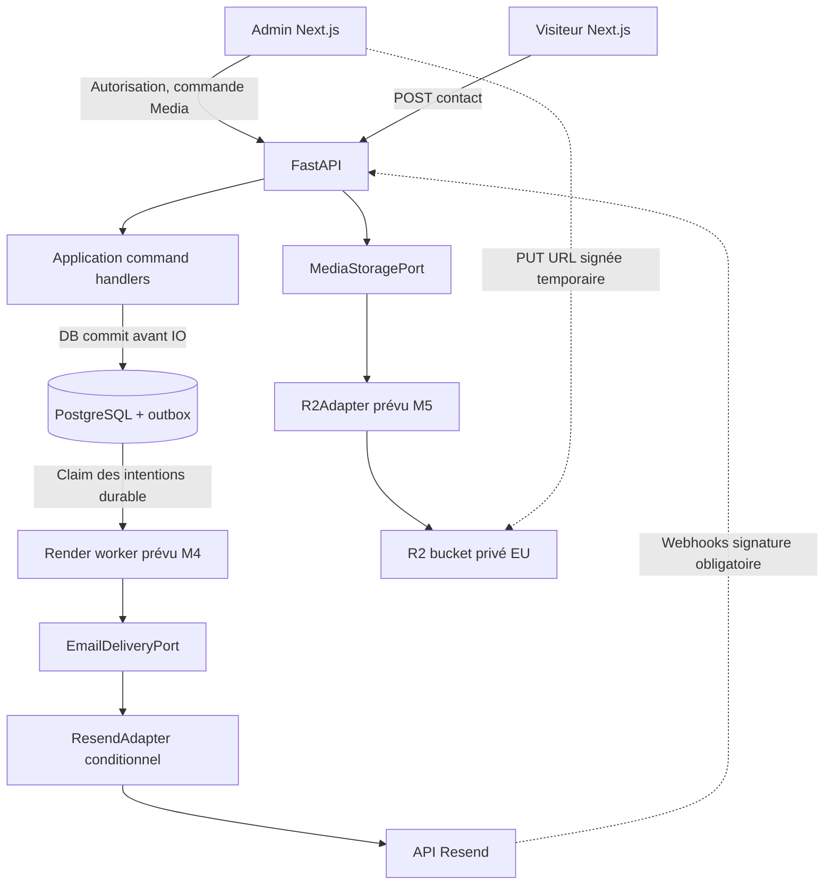
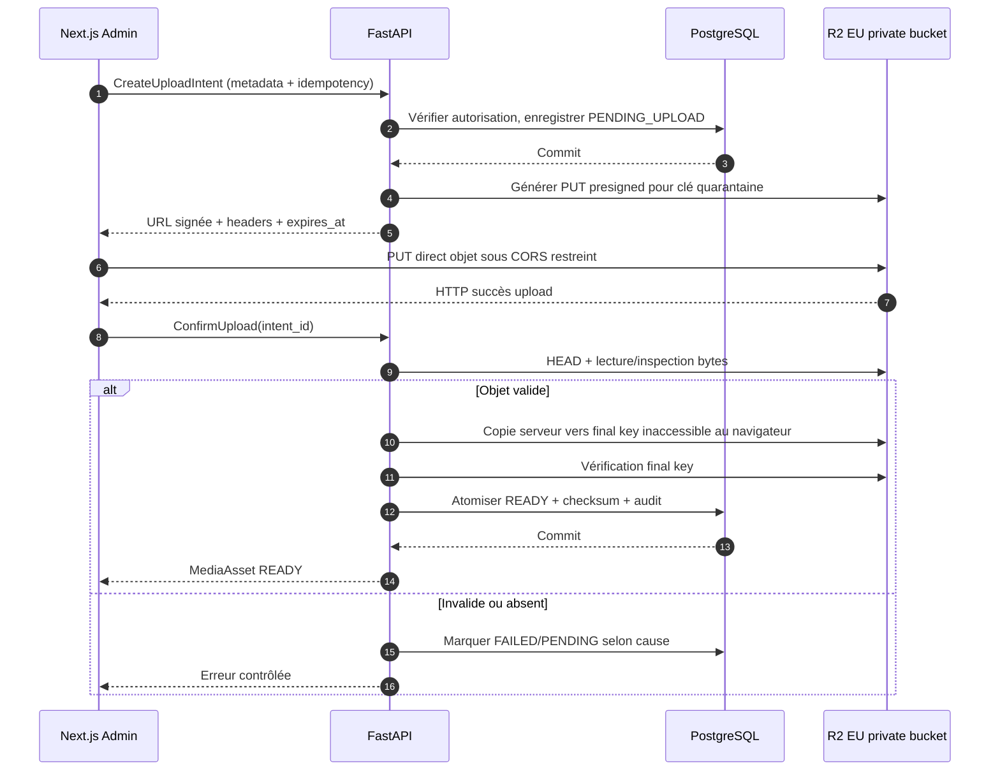

# BE-000-06 - Contrats de ports d'intégration Email et Media

| Champ | Valeur |
|---|---|
| Version documentaire | 1.0.0 |
| Ticket | BE-000-06 |
| Jalon | M0 |
| Statut | ACCEPTED_DESIGN / NOT IMPLEMENTED |
| ADR | `docs/adr/ADR-0006-email-storage-providers.md` |
| Domaines | Contact, Media, Audit, Infrastructure |
| Dépendances ouvertes | BE-000-08 (state crosswalk), BE-000-09 (outbox), BE-000-07 (codes HTTP) |
| Propriété | Ports en Application, adapters en Infrastructure, règles métier en Domain |

Ce document spécifie **des interfaces à développer plus tard** et non des classes importables ou des endpoints déployés.

## 1. Architecture logique cible



La transaction locale n'inclut aucun appel fournisseur. Le flux de reprise du worker relève de BE-000-09.

## 2. `EmailDeliveryPort`

### 2.1 Types logiques de l'entrée

```python
# Pseudocode contractuel, NON implémenté
class EmailNotification:
    contact_submission_id: UUID         # ID opaque, jamais email du prospect
    delivery_intent_id: UUID             # intention durable issue de PostgreSQL
    template_code: str                   # ex: CONTACT_NEW_INTERNAL_V1
    template_version: int
    locale: Literal["fr", "en"]
    recipient_group: str                 # référence à liste autorisée en configuration
    safe_admin_deeplink: str             # lien vers Admin qui exige login
    correlation_id: str

class IdempotencyContext:
    logical_delivery_id: UUID            # stable au travers de tous les retries
    dedup_key: str                       # sans PII, <=256 caractères pour Resend
    payload_hash: str                    # hash du template, version et destinataires
    original_created_at: datetime        # UTC aware
    attempt_number: int                  # numérotation dans l'application

class DeliveryOutcome:
    status: Literal["SUCCEEDED", "RETRYABLE_FAILURE", "PERMANENT_FAILURE"]
    provider_reference: str | None       # id fournisseur, pas un statut de lecture
    accepted_at: datetime | None
    acceptance_uncertain: bool           # True en cas de timeout après possible acceptation
    provider_code: str | None            # code stable et assaini
    retry_after: datetime | None         # UTC si connu
    reconciliation_required: bool
    correlation_id: str

class EmailDeliveryPort(Protocol):
    def send_contact_notification(
        self, notification: EmailNotification, idempotency_context: IdempotencyContext
    ) -> DeliveryOutcome: ...
```

### 2.2 Invariants

- `SUCCEEDED` signifie **fournisseur a accepté la demande**, jamais email livré.
- `provider_reference` est obligatoire pour `SUCCEEDED` si le fournisseur expose un ID, comme Resend. ID absent lors d'un statut accepté doit déclencher une anomalie d'adapter, pas une livraison inventée.
- Le payload d'une même clé de déduplication doit être strictement identique; sinon erreur de conflit et intervention opérateur.
- `PERMANENT_FAILURE` désigne un payload invalide/domaine non autorisé/destination invalide nécessitant correction. Un problème de configuration (clé expirée) bloque les retries jusqu'à correction, plutôt que boucler.
- `RETRYABLE_FAILURE` : 429, 5xx ou timeout réseau, politique exponentielle plafonnée, jitter et limite de tentatives définis à BE-000-09.
- Timeout avec acceptation ambiguë : `RETRYABLE_FAILURE` et `acceptance_uncertain=True`. Si fenêtre provider idempotency expirée, `reconciliation_required=True` avant nouvel envoi manuel.
- Pas de promesse `exactly-once`: outbox applicative + déduplication provider à durée limitée.
- La réception de `email.delivered`/`email.bounced` corrèle un événement webhook au provider_ref et n'est pas déterminée par le retour de `send_contact_notification`.
- Ne jamais mettre la PII Contact dans le sujet d'email, les métadonnées ou le lien d'administration. Le corps de message contient un avis neutre et le lien vers la fiche restreinte, sans réponse publique sur son existence.

### 2.3 Règles d'erreurs (propositions applicatives)

| Famille | Outcome / signal | Décision |
|---|---|---|
| HTTP 2xx avec id provider | `SUCCEEDED` / accepted | Transaction locale terminée; enregistrer preuve de transport |
| HTTP 400 payload invalid | `PERMANENT_FAILURE` | Corriger données/template, ne pas réessayer à l'identique |
| HTTP 401/403 credentials/domaine | `PERMANENT_FAILURE` + OPS_BLOCKED_CONFIG | Ne pas boucler, alerter opérateur |
| HTTP 409 même clé + payload différent | `PERMANENT_FAILURE` + IDEMPOTENCY_CONFLICT | Stop et investigation |
| HTTP 409 concurrent same key | `RETRYABLE_FAILURE` | Retenter plus tard même clé |
| HTTP 429 | `RETRYABLE_FAILURE` | Respecter `Retry-After` si présent |
| HTTP 5xx | `RETRYABLE_FAILURE` | Backoff, retry budget |
| Timeout / connexion coupée | `RETRYABLE_FAILURE` + `acceptance_uncertain` | Vérifier état id provider, puis retry prudent |

**Les codes HTTP exacts sont des cas typiques, à confirmer contre le provider et la version SDK en M4.**

### 2.4 Webhook verifier (port séparé, pas `send`)

```python
class EmailWebhookVerificationPort(Protocol):
    def verify_and_parse(self, raw_body: bytes, headers: Mapping[str,str]) -> VerifiedEmailEvent: ...

class VerifiedEmailEvent:
    event_id: str
    event_type: str  # SENT / DELIVERED / BOUNCED / FAILED etc. après mapping
    provider_reference: str
    occurred_at: datetime
```

- Vérification **signature sur bytes bruts** et horodatage/tolérance avant désérialisation de confiance; clé webhook dans store secret.
- Refus des signatures invalides, des corps non conformes et des événements trop anciens selon une politique bornée.
- Déduplication de `event_id` et transitions autorisées dans le domaine; pas de régression de `DELIVERED` vers `PENDING` causée par webhook en retard.
- N'exposer aucun détail de PII dans logs, audit techniques ou réponse webhooks.
- N'accepter un événement que depuis une route webhook dédiée, jamais depuis l'API publique Contact.

## 3. `MediaStoragePort`

### 3.1 Types et méthodes

```python
class UploadIntentRequest:
    asset_id: UUID
    actor_id: UUID
    filename_safe: str
    declared_mime: str
    declared_size_bytes: int
    claimed_sha256: str | None
    idempotency_key: str

class SignedUploadIntent:
    media_asset_id: UUID
    intent_id: UUID
    storage_key: str              # quarantaine générée par serveur
    method: Literal["PUT"]
    upload_url: str               # secret temporaire à ne jamais logguer
    required_headers: dict[str, str]
    expires_at: datetime         # UTC
    declared_max_size: int       # limite de politique, non preuve d'application R2

class ObjectHead:
    key: str
    byte_size: int
    content_type: str | None
    etag: str | None
    last_modified: datetime | None

class InspectedObject:
    key: str
    verified_mime: str
    byte_size: int
    sha256: str
    width: int
    height: int
    verified_at: datetime

class MediaStoragePort(Protocol):
    def create_upload_intent(self, request: UploadIntentRequest) -> SignedUploadIntent: ...
    def head_object(self, key: str) -> ObjectHead | None: ...
    def read_or_inspect_object(self, key: str) -> InspectedObject: ...
    def delete_object(self, key: str, *, authorized_deletion_id: UUID) -> None: ...
    def resolve_public_url(self, key: str, *, readiness_proof_id: UUID) -> str: ...
```

Les méthodes décrivent le **contrat applicatif**, pas les signatures boto3 ou R2. Une couche applicative gère l'intent persistée, l'autorisation, le cycle de vie, les statuts et l'audit. Le port n'assimile jamais un `HEAD` réussi à un média vérifié.

### 3.2 Politique de contenu du MVP

| Règle | Valeur proposée | Preuve requise M5 |
|---|---|---|
| Types autorisés | jpeg, png, webp, avif | Sniff bytes réel et test de décodage |
| SVG arbitraire | Interdit | Rejet API |
| Taille minimale | `> 0` octet | Refus zéro octet |
| Taille max | 10 MiB | Contrôle avant et après PUT |
| URL PUT validité | 300 secondes | Test d'expiration |
| Nom de l'objet | `quarantine/{intent_id}/{uuid}` | Non contrôlable par client |
| Objet final | `media/{media_asset_id}/{revision}/original` | Seul backend peut écrire |
| Métadonnées | sha256 serveur, dimensions, MIME réel | Double check bytes/final key |
| Publication | `MediaAsset READY` + politique d'accès | Test absence de fuite d'objets non READY |
| Corbeille / suppression | Archivage logique et références contrôlées | Essai suppression média encore utilisé |

### 3.3 Processus cible



Attention : le passage au statut READY dépend **aussi** de la cohérence et de la disponibilité du binaire final. Un crash après copie et avant commit peut laisser un objet final orphelin : prévoir réconciliation et garbage collection en M5.

### 3.4 Erreurs de stockage et sécurité

| Erreur | Sémantique application | Comportement |
|---|---|---|
| `UPLOAD_INTENT_EXPIRED` | URL PUT arrivée à échéance | Ré-authentifier, renouveler intention avant réessai |
| `UPLOAD_NOT_FOUND` | HEAD 404 / upload absent | Rester PENDING jusqu'au délai, puis marquer FAILED |
| `MEDIA_TOO_LARGE` | dépasse 10 MiB | Refuser, nettoyer quarantaine |
| `UNSUPPORTED_MEDIA_TYPE` | MIME/bytes réel incohérent | Refuser |
| `MEDIA_CORRUPT` | Image illisible ou dimensions invalides | Refuser, ne jamais READY |
| `STORAGE_TEMPORARY_FAILURE` | 429/5xx/timeout R2 | Retry limité, pas de publication |
| `UNAUTHORIZED_MEDIA_ACCESS` | actor non autorisé | Refuser avec audit sécurité |
| `MEDIA_IN_USE` | tentative suppression référencée | Refuser en Domain |
| `OBJECT_INTEGRITY_CONFLICT` | checksum final vs inspect différent | Quarantaine + alerte |

- Une URL PUT signée n'est **pas à usage unique** : elle peut être réutilisée pendant sa validité. Ne pas donner de droit d'écriture au client sur la clé finale.
- Le contrôle `Content-Type` signé est uniquement une contrainte de **header**, pas une inspection anti-malware/image. Les mécanismes de checksum doivent être vérifiés sur le contenu effectivement promu.
- Les URL signées R2 ciblent l'endpoint **S3 API**, pas les domaines personnalisés. Les URL signées sont des secrets temporaires; ne pas les écrire dans les logs.
- Les clients ne peuvent pas décider arbitrairement de la clé, du bucket, du chemin de lecture externe ou du niveau d'accès public.
- `resolve_public_url` choisit un URL sécurisé ou un CDN approuvé uniquement si média READY/autorisé; ne pas exposer des URL non vérifiées.

## 4. Politique de données et dépendances

- Système de vérité Contact : PostgreSQL. Le fournisseur Email n'a qu'un `provider_reference` transport.
- Système de vérité Media : PostgreSQL métadonnées et lifecycle; R2 pour les **binaires**.
- Les versions localisées du texte alternatif (alt) restent des données métier, pas des métadonnées R2 autoritatives.
- Les binaires sont distincts de l'objet HTTP qui les transporte; pas d'octets média dans JSONB Content/Media.
- Outbox Contact/revalidation et déduplication webhook : **BE-000-09**.
- Crosswalk des états `ContactStatus`/`ContactDelivery`/`MediaStatus` : **BE-000-08**.
- Noms/code d'erreur HTTP finalisés dans **BE-000-07**, les codes ici sont des exemples contractuels provisoires.
- Respecter la minimisation PII, restriction d'accès, purge et droits RGPD. Aucun contenu Contact ni document de santé patient ne doit être envoyé à un fournisseur externe non qualifié.

## 5. Tests : références et gate

La matrice détaillée est `docs/contracts/integration-provider-test-matrix.md`. Tous ses tests sont **PLANNED / NOT EXECUTED**. La livraison de ce document ne prouve ni connexion au fournisseur ni conformité juridique.

**Acceptance BE-000-06** :
- [x] Interfaces, inputs/outputs, erreurs, expiration, signatures et idempotence définis.
- [x] Providers cibles / Fake adapter staging sélectionnés, avec condition de Privacy explicite.
- [x] Résultat HTTP d'envoi distingué de la preuve de livraison.
- [x] Vérification réelle de bytes médias exigée avant READY.
- [x] Contrôle des clés, cookies, bucket EU et secrets documenté.
- [ ] Tests M4/M5 effectivement exécutés, nécessaires avant mise en service.
- [ ] Revue juridique / DPA des emails réels, impérative avant tout Contact PII.


## Addendum BE-000-08 : alignement des etats et permissions

- La reponse `DeliveryOutcome.SUCCEEDED` prouve l'**acceptation par l'API Email**, pas la reception. Elle est projetee en dispatch `ACCEPTED`; `DELIVERED` exige une preuve webhook.
- `SignedUploadIntent` est une intention distincte du `MediaAsset`. Le statut canonique de ce dernier debute a `UPLOADING`, devient `PROCESSING`, puis `READY` ou `FAILED` selon l'inspection.
- L'autorisation d'upload requiert la permission canonique `MANAGE_MEDIA` (IAM source 15). Le terme `MEDIA_UPLOAD` de propositions anterieures n'est pas une permission FPS.
- Le media non decoratif doit avoir un alt dans la locale de **publication**; l'absence d'alt peut etre toleree en brouillon, mais pas en publication d'un bloc non decoratif.

Reference normative de reconciliation : `docs/adr/ADR-0007-domain-state-and-revisions.md`, BE-000-08. Aucun code adapte ni test execute dans ce lot documentaire.
