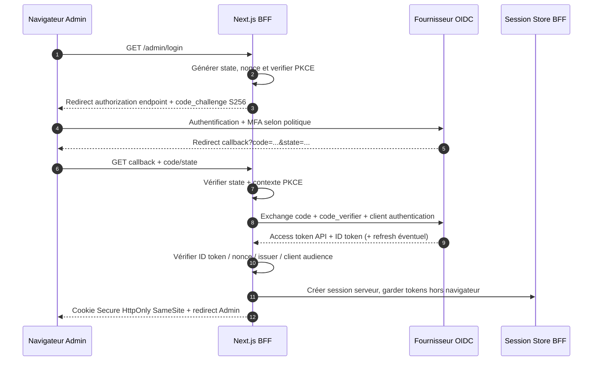
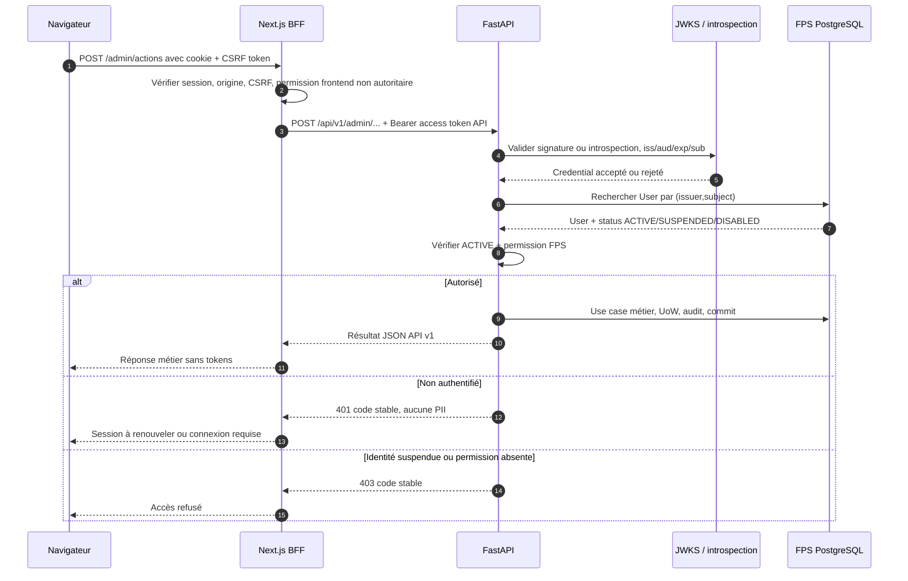
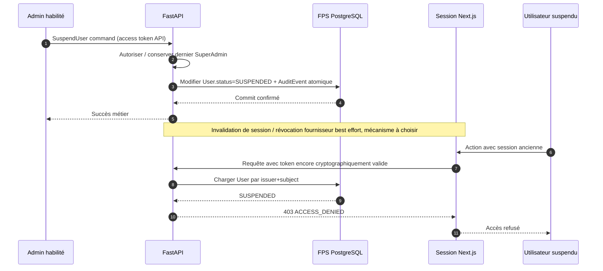

# BE-000-04 - Contrats et séquences OIDC / BFF / FastAPI

- **Date :** 2026-11-25
- **Statut :** ACCEPTED CONTRACT / NOT IMPLEMENTED
- **Référence :** `docs/adr/ADR-0003-oidc-bff-auth.md`
- **Sources internes :** `09_FPS_CONTENT_PLATFORM_API_ARCHITECTURE.md`, `15_FPS_CONTENT_PLATFORM_IDENTITY_AND_ACCESS_MODEL.md`, `17_FPS_CONTENT_PLATFORM_SECURITY_PRIVACY_AND_COMPLIANCE_MODEL.md`, plan M0 §BE-000-04.
- **But :** contrat suffisamment testable sans code FastAPI ni fournisseur OIDC actif.

## 1. Diagramme de connexion (Authorization Code + PKCE)



**Interdits :** flux implicit pour Admin MVP, access/refresh tokens en storage navigateur, callback sans vérification de `state`, `redirect_uri` ouverte et exposition de secrets dans HTML.

## 2. Diagramme d'une commande Admin



**Important :** le BFF n'est pas autorité des rôles; la validation de signature peut reposer sur des clés JWKS mises en cache et contrôlées, pas sur une requête distante à chaque appel. Pour les tokens opaques, introspection selon le contrat fournisseur.

## 3. Diagramme de suspension



Le serveur doit **refuser l'autorisation même si le cookie BFF ou l'access token n'a pas encore expiré**. Pas de cache long du statut FPS côté API sans stratégie d'invalidation sécurisée.

## 4. Contrat des claims, clés et sessions

| Champ | Validé où | Politique proposée |
|---|---|---|
| `iss` | API et BFF au besoin | Correspondance exacte avec issuer configuré / discovery |
| `aud` | API | Audience FPS API requise, ID token destiné à BFF non accepté |
| `sub` | API | Non vide; référence externe jointe à `iss` |
| `exp` | API | Non expiré, tolérance d'horloge bornée et documentée |
| `nbf` | API | Non prématuré, si présent |
| `alg` | API | Liste explicite d'algorithmes attendus, pas de `none` |
| `kid` | API | Sélection de clé uniquement dans JWKS approuvées |
| OIDC `nonce` | BFF | Associé au login, vérifié dans l'ID token lorsque requis |
| `state` et PKCE | BFF | Corrélation requête/callback et code challenge S256 |
| `roles` / `email` | API | Non autoritaires pour RBAC FPS, aucune élévation implicite |
| Cookie session | BFF | HttpOnly, Secure, SameSite, renouvellement/expiration |
| CSRF | BFF | Token de session anti-CSRF + Origin/Referer selon méthode |

## 5. Interface DTO ciblée

**`GET /api/v1/admin/me`**, disponible seulement après bearer valide + statut FPS actif :

```json
{
  "user_id": "opaque-fps-user-id",
  "status": "ACTIVE",
  "roles": ["EDITOR"],
  "permissions": ["CONTENT_READ", "CONTENT_EDIT"]
}
```

**Erreurs canoniques candidates** (schéma final à BE-000-07) :

```json
{
  "code": "PERMISSION_DENIED",
  "message": "Access denied.",
  "details": {},
  "correlation_id": "opaque-request-id"
}
```

- Rejeter token absent : 401
- Rejeter token invalide : 401
- Rejeter status SUSPENDED/DISABLED : 403
- Rejeter permission insuffisante : 403
- Rejeter CSRF BFF : 403 (pas de transfert à FastAPI)
- Rejeter HTTP BFF sans session : 401/redirect selon endpoint de navigation

## 6. Matrice de tests contractuels (PLANNED)

| Test | Scénario | Attendu | Preuve actuelle |
|---|---|---|---|
| AUTH-001 | Aucun token Admin | 401, no mutation | MISSING |
| AUTH-002 | Signature JWT invalide | 401 | MISSING |
| AUTH-003 | `iss` invalide | 401 | MISSING |
| AUTH-004 | `aud` invalide / ID token substitué | 401 | MISSING |
| AUTH-005 | Token expiré | 401 | MISSING |
| AUTH-006 | `sub` absent | 401 | MISSING |
| AUTH-007 | Claim `role=SUPER_ADMIN` sans rôle DB | 403 pour action privilégiée | MISSING |
| AUTH-008 | User `SUSPENDED` avec token valide | 403 | MISSING |
| AUTH-009 | User `DISABLED` avec token valide | 403 | MISSING |
| AUTH-010 | User ACTIVE sans permission | 403 | MISSING |
| AUTH-011 | User ACTIVE avec permission | Succès de l'action autorisée | MISSING |
| AUTH-012 | Mutation BFF sans anti-CSRF valide | 403, FastAPI non contacté | MISSING |
| AUTH-013 | Clé JWKS tournée | Validation selon période de cache contrôlée | MISSING |
| AUTH-014 | JWKS indisponible et pas de clé fiable | Refus sûr, pas de bypass | MISSING |
| AUTH-015 | Tentative de suspension dernier SuperAdmin | Rejet métier | MISSING |
| AUTH-016 | Token ou données privées en logs | Aucune fuite | MISSING |
| AUTH-017 | Appel Admin navigateur direct avec headers user forgés | 401/403, jamais élévation | MISSING |
| AUTH-018 | Callback avec `state` modifié | Connexion rejetée | MISSING |
| AUTH-019 | Refresh token/session expirés | Renouvellement valide ou déconnexion sûre | MISSING |
| AUTH-020 | `GET /api/v1/admin/me` avec User ACTIVE | DTO minimal attendu | MISSING |

**Tous les tests sont planifiés et aucun n'est exécuté en M0.**

## 7. Gate de revue documentaire

- [x] Login + appel Admin + suspension modélisés.
- [x] Validation cryptographique et authorization FPS différenciées.
- [x] Mauvaise confiance dans headers simples explicitement interdite.
- [x] Cookies, CSRF, MFA et expiration mentionnés.
- [x] Matrice de tests 401/403 fournie.
- [x] Stratégie BFF + bearer API approuvée le 2026-11-25.
- [x] Sélection du fournisseur OIDC formellement reportée avant M3; point de revue au 2026-12-09 ou plus tôt si M3 commence avant.
- [x] Pilote technique FPS désigné comme responsable fonctionnel, porteur du projet jusqu'à attribution nominative.

**Statut : ACCEPTED en tant que contrat documentaire.** Aucun test AUTH n'a été exécuté. La sélection/configuration du fournisseur reste un prérequis impératif avant M3.
