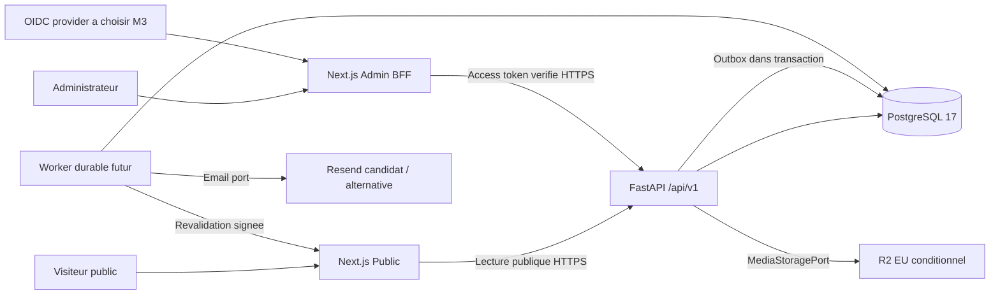

# FPS Content Platform - Bilan post-réalisation du jalon M0

> **Décision de clôture : GO M0, strictement pour ouvrir M1 / PR-BE-01.** Le rapport officiel de Gate M0 version 2.0 est fusionné dans `main`, via la [PR #17](https://github.com/tawounfouet/fastapi-fps-platform/pull/17), au commit `617f318746ecbfaf2bc21dd7836a720bbc225f98`. Ce GO n'est **ni** une mise en production, **ni** la validation d'une application métier FastAPI opérationnelle, **ni** une autorisation de traiter des données personnelles réelles.

> **Convention de lecture.** Le terme *post-implémentation M0* désigne ici l'exécution et la qualification **du jalon M0** : dépôt, architecture, arbitrages, contrats, matrices de vérification et probe technique isolé. L'application FPS elle-même, ses migrations métier, son IAM, son Contact et son CMS ne sont pas implémentés dans `main` à la clôture de M0. Le premier lot de code applicatif reste M1.

## Synthèse exécutive

Le jalon M0 a converti une documentation d'architecture et un plan d'implémentation initialement au statut `PROPOSED / NOT STARTED` en une **baseline technique gouvernée**, accompagnée d'une traçabilité de besoins, de contrats explicites et de preuves reproductibles d'installabilité de la stack. Le point critique de la clôture est le traitement de `BE-000-03`, longtemps limité à un choix d'architecture : après une première revue en **NO-GO**, une qualification GitHub Actions a finalement réussi la résolution `uv`, l'installation verrouillée, une connexion PostgreSQL 17 réelle et les tests Docker. Cette preuve a permis la décision finale **GO pour M1**.

| Indicateur | Résultat constaté | Lecture correcte |
|---|---:|---|
| Tickets du plan M0 | **12** (`BE-000-01` à `BE-000-12`) | Cadrage livré et qualifié au niveau requis pour M1, pas code métier réalisé |
| Pull Requests numérotées #1 à #17 | **17** | Il s'agit de numéros de PR, pas de 17 fusions |
| Pull Requests effectivement fusionnées | **14** | PR #1 à #11, #13, #16 et #17 |
| Pull Requests closes sans fusion | **3** | PR #12, #14 et #15, tentatives M1 non intégrées |
| Artefacts M0 minimaux du plan | **6/6** examinés | `M0-A01` à `M0-A06`, avec niveau de preuve différencié |
| Exigences P0 tracées | **60/60** | Une cible de test et un owner de suivi pour chacune |
| Exigences P1 tracées | **26/26** | Pas une promesse de livraison P1 dans le MVP |
| Scénarios identifiés dans 7 matrices de tests spécialisées | **383** | **Planifiés/documentés**, non exécutés en bloc |
| Identifiants de tests de qualification dans la matrice de traçabilité | **86** | `QUAL-<RequirementId>`, distincts des tests logiciels présents |
| Tests stricts réellement réussis sur le runner CI | **6/6** | Suite de compatibilité isolée, sous Python 3.13 et PG17 |
| Tests stricts réellement réussis dans Docker | **6/6** | **Les mêmes six cas** dans un second environnement, pas six nouveaux domaines fonctionnels |
| Paquets résolus dans le lockfile de qualification | **33** | `docs/qualification/runtime-probe/uv.lock`, distinct du futur lockfile applicatif racine |
| PostgreSQL utilisé pour la qualification | **17.12** | Base éphémère GitHub Actions, pas une instance managée FPS |
| Verdict historique | **NO-GO** | Conservé et consultable dans le dossier `history/` |
| Verdict final | **GO** | Autorisation déléguée **limitée à M1**, sans revue indépendante revendiquée |

**Appréciation du résultat :** M0 remplit sa fonction principale de réduction des ambiguïtés avant les travaux structurants de M1. Le succès le plus significatif n'est pas le volume de documents produits, mais la chaîne **source -> décision -> contrat -> test candidat -> preuve vérifiée -> Gate**. Le principal risque résiduel serait de confondre ce niveau de préparation avec une application opérationnelle ou prête à recevoir du trafic et des données réelles.

---

# 1. Objet, méthode et périmètre du bilan

## 1.1. Questions auxquelles ce document répond

Le bilan est conçu pour répondre avec des éléments vérifiables aux questions suivantes :

1. Quelles décisions et quel patrimoine documentaire existaient avant M0 ?
2. Quels tickets ont été couverts, par quelles PR et avec quels résultats ?
3. Quels arbitrages ont réellement été acceptés, et quelles questions ont été reportées ?
4. Quelles preuves logicielles ou infrastructurelles ont été **exécutées**, et lesquelles restent des tests candidats ?
5. Pourquoi le Gate a-t-il d'abord conclu NO-GO, puis GO ?
6. Que signifie précisément le GO accordé, et que n'autorise-t-il pas ?
7. Quels défauts de méthode, risques et dépendances faut-il traiter avant M1 et aux jalons suivants ?
8. Quel est le premier incrément technique à produire maintenant ?

## 1.2. Sources d'autorité et méthode de vérification

Les sources primaires sont le plan M0 [`21_FPS_CONTENT_PLATFORM_FASTAPI_M0_BASELINE_DECISIONS_AND_CONTRACTS_IMPLEMENTATION_PLAN(1).md`](#annexe-a-sources-dautorité), son plan parent `20_..._END_TO_END_IMPLEMENTATION_PLAN(1).md`, les documents FPS `00` à `18` disponibles dans le projet, ainsi que les fichiers et métadonnées actuels du dépôt privé [`fastapi-fps-platform`](https://github.com/tawounfouet/fastapi-fps-platform).

Vérifications mobilisées pour le présent bilan :

- lecture du **plan M0 exact** et du plan parent, sans prendre les recommandations initiales pour des décisions déjà approuvées ;
- réouverture sur `main` des rapports de Gate et de runtime, de la baseline, des contrats, ADR, matrices et du manifeste de migration ;
- interrogation GitHub des PR #1 à #17 pour distinguer **merged** de **closed / not merged** ;
- vérification de la conclusion du workflow de qualification correspondant au commit réellement testé ;
- dénombrement des lignes réellement présentes dans les fichiers de test et des exigences du registre JSON ;
- constat de l'absence, dans `main`, du `pyproject.toml` applicatif racine et du module `src/fps_api/main.py` à la date de vérification.

**Hiérarchie de preuve retenue :** (1) code et résultat de CI ou métadonnée GitHub observés ; (2) document fusionné dans `main` et traçable à une PR ; (3) décision de conception formalisée ; (4) plan de test non exécuté ; (5) recommandation ou hypothèse future. Les catégories ne sont jamais substituées silencieusement les unes aux autres.

## 1.3. Définition du jalon M0

Le plan M0, daté du **24 novembre 2026**, définissait un jalon de **baseline, décisions, contrats et alignement des sources**. Le résultat attendu était un dossier suffisamment précis pour permettre le premier commit structurant du backend, avec les ambiguïtés bloquantes fermées. **M0 ne visait pas à implémenter les agrégats métier, créer les migrations de domaines, activer un fournisseur réel ou déployer une API de production.**

Le plan parent décrit l'architecture cible : monolithe modulaire FastAPI, PostgreSQL comme source de vérité métier, Next.js Public/Admin comme consommateurs, Domain indépendant du framework et des SDK externes, couches Application/API/Infrastructure séparées, transactions et audit explicites, et qualification progressive des intégrations.

## 1.4. Pourquoi ce bilan n'est pas un bilan de mise en production

Les termes `DONE`, `MERGED`, `ACCEPTED_DESIGN`, `VERIFIED_TECHNICAL_FOR_M0`, `NOT_IMPLEMENTED`, `NOT_EXECUTED` et `GO` n'ont pas la même portée :

| Terme | Signification utilisée ici |
|---|---|
| `MERGED` | Les commits de la PR sont intégrés à `main` et GitHub confirme la fusion |
| `ACCEPTED_DESIGN` | Arbitrage architectural accepté pour guider le code ; comportement non nécessairement exécuté |
| `VERIFIED_DOCUMENTARY` | Document, mapping ou registre présent et vérifié structurellement |
| `NOT_EXECUTED` | Test candidat rédigé, sans preuve d'exécution |
| `VERIFIED_TECHNICAL_FOR_M0` | Preuve runtime reproduite en CI sur le **probe de compatibilité** |
| `GO M0` | Autorisation de **commencer** M1, limitée à son périmètre |
| `READY_FOR_PRODUCTION` | **Non acquis** ; validations métiers, sécurité, RGPD, exploitation et déploiement à venir |

---

# 2. Situation initiale et transformation recherchée

## 2.1. Le contexte produit

La plateforme vise à sortir d'une logique où les contenus, formulaires et règles de publication sont fortement liés au frontend historique React/Vite, pour aboutir à une architecture où :

- **FastAPI** possède les règles métier, validations, versions, autorisations, demandes de contact, références média et traces d'audit ;
- **PostgreSQL** possède les données métier et les événements durables ;
- **Next.js** porte la présentation publique, le dashboard d'administration et la frontière BFF lorsque nécessaire ;
- les fournisseurs **Email** et **Object Storage** sont accessibles derrière des ports ;
- les décisions de publication et de sécurité sont prises côté backend, jamais uniquement dans le navigateur.

L'ambition n'était pas de migrer immédiatement les pages, mais de rendre la future migration vérifiable, réversible et sans perte de données.

## 2.2. Incertitudes structurantes au démarrage

Avant M0, plusieurs décisions restaient ouvertes ou ambiguës : topologie multi-repo versus monorepo ; session SQLAlchemy synchrone ou asynchrone ; provider OIDC et confiance entre BFF et API ; hébergement, région, secrets et backups ; semantics des Email/Media ; enveloppe d'erreur HTTP ; divergences entre workflow de contenu et états de base ; persist-first sans reprise après crash ; granularité des schémas JSONB ; règles FR/EN ; inventaire des contenus Vite et stratégie de cutover.

L'absence d'une preuve d'installabilité pour la combinaison Python/FastAPI/SQLAlchemy/psycopg était également un risque **immédiatement bloquant** pour un passage justifié à M1.

## 2.3. Résultat organisationnel du pivot M0

L'exécution de M0 a matérialisé une discipline de livraison fondée sur :

1. des **ADR** présentant alternatives, décisions, limites et échéances de revue ;
2. des **contrats versionnés** plutôt que des hypothèses tacites au moment de coder ;
3. des **matrices de tests** explicites, toutes marquées non exécutées tant que les suites ne sont pas développées ;
4. une **traçabilité par exigences** vers cas d'usage, routes, droits, tables et validations ;
5. une **séparation des gates** M0, M1, M2, etc. ;
6. une **chaîne de preuves CI** pour lever un blocage décisif.

---

# 3. Chronologie réelle et audit des Pull Requests

## 3.1. Séquence des livraisons M0

| PR | Objet de la livraison | État GitHub vérifié | Apport au jalon |
|---|---|---|---|
| [#1](https://github.com/tawounfouet/fastapi-fps-platform/pull/1) | Baseline et topologie `BE-000-01/02` | **Fusionnée** | Dépôt privé, `main`, SHA, choix de livraison autonome |
| [#2](https://github.com/tawounfouet/fastapi-fps-platform/pull/2) | Runtime `BE-000-03` | **Fusionnée** | Python 3.13, SQLAlchemy sync, psycopg3, stratégie UoW ; preuve encore incomplète |
| [#3](https://github.com/tawounfouet/fastapi-fps-platform/pull/3) | Confiance OIDC/BFF `BE-000-04` | **Fusionnée** | Contrat de confiance, RBAC et protections 401/403 |
| [#4](https://github.com/tawounfouet/fastapi-fps-platform/pull/4) | Infrastructure `BE-000-05` | **Fusionnée** | Topologie Render Francfort / PostgreSQL 17, sans provisionnement |
| [#5](https://github.com/tawounfouet/fastapi-fps-platform/pull/5) | Intégrations `BE-000-06` | **Fusionnée** | Ports Email/Media, fournisseurs conditionnels, règles Privacy |
| [#6](https://github.com/tawounfouet/fastapi-fps-platform/pull/6) | Contrat HTTP `BE-000-07` | **Fusionnée** | API v1, OpenAPI 3.1 **draft**, matrice de tests |
| [#7](https://github.com/tawounfouet/fastapi-fps-platform/pull/7) | États métier `BE-000-08` | **Fusionnée** | Crosswalk ST-01..ST-08, invariants, révisions, permissions |
| [#8](https://github.com/tawounfouet/fastapi-fps-platform/pull/8) | Durabilité `BE-000-09` | **Fusionnée** | Outbox, retries, Email, revalidation Next.js |
| [#9](https://github.com/tawounfouet/fastapi-fps-platform/pull/9) | Traçabilité `BE-000-10` | **Fusionnée** | 60 P0, 26 P1, registre JSON et rapport de contrôle |
| [#10](https://github.com/tawounfouet/fastapi-fps-platform/pull/10) | Schémas JSONB `BE-000-11` | **Fusionnée** | ADR et contrat ContentBlocks, fixtures et tests candidats |
| [#11](https://github.com/tawounfouet/fastapi-fps-platform/pull/11) | Migration legacy `BE-000-12` | **Fusionnée** | Source Vite observée, manifeste, import et rollback planifiés |
| [#12](https://github.com/tawounfouet/fastapi-fps-platform/pull/12) | Tentative de bootstrap M1 | **Close sans fusion** | Ne fait **pas** partie du code livré à `main` |
| [#13](https://github.com/tawounfouet/fastapi-fps-platform/pull/13) | Première revue formelle M0 | **Fusionnée** | Preuves partielles BE-000-03, verdict **NO-GO** |
| [#14](https://github.com/tawounfouet/fastapi-fps-platform/pull/14) | Nouvelle tentative de bootstrap M1 | **Close sans fusion** | Non intégrée ; description PR évoque remédiation GitGuardian |
| [#15](https://github.com/tawounfouet/fastapi-fps-platform/pull/15) | Troisième tentative de bootstrap M1 | **Close sans fusion** | Non intégrée ; reste une tentative, pas un jalon M1 livré |
| [#16](https://github.com/tawounfouet/fastapi-fps-platform/pull/16) | Qualification technique BE-000-03 | **Fusionnée** | Workflow réel, lockfile 33 paquets, PG17 et Docker validés |
| [#17](https://github.com/tawounfouet/fastapi-fps-platform/pull/17) | Gate M0 final | **Fusionnée** | Historique NO-GO archivé, preuve machine-readable et **GO limité à M1** |

**Comptage précis :** 14 PR fusionnées, 3 fermées sans fusion, 17 PR numérotées. Le tableau de bord ou une image de synthèse affichant « 17 PR fusionnées » serait **inexact** ; il convient de corriger les visuels futurs en indiquant « 17 PR numérotées / 14 fusionnées ».

## 3.2. Point de vigilance : trois tentatives M1 non intégrées

Les PR [#12](https://github.com/tawounfouet/fastapi-fps-platform/pull/12), [#14](https://github.com/tawounfouet/fastapi-fps-platform/pull/14) et [#15](https://github.com/tawounfouet/fastapi-fps-platform/pull/15) sont toutes **closed / merged=false**. Leurs descriptions annoncent du code FastAPI, des tests locaux et des Docker builds, mais ces annonces ne prouvent **pas** une livraison dans `main`, ni une validation distante ; aucune ne peut être comptée comme « M1 terminé ».

Les descriptions de #14 et #15 indiquent que des alertes GitGuardian sur des valeurs ressemblant à des mots de passe dans des fichiers Compose/CI ont motivé des révisions et de nouvelles branches. Ce bilan **attribue cette explication aux descriptions de PR** ; il ne revendique pas une consultation indépendante des événements GitGuardian. Le problème fournit néanmoins un enseignement opérationnel : **les secrets, y compris des identifiants fictifs de tests, peuvent bloquer un pipeline de sécurité lorsqu'ils sont codés en dur**. En M1, privilégier des secrets de test injectés par environnement autorisé, des fakes sans credentials, un scanner de secrets et une procédure formelle de résolution de faux positifs.

**Conséquence architecturale :** même si des tentatives M1 précoces ont existé, aucune n'est un artefact applicatif fusionné à la clôture de M0. Cette distinction protège l'intégrité des indicateurs d'avancement.

## 3.3. La boucle de décision NO-GO -> GO

| Séquence | Événement réellement documenté | Verdict à ce moment |
|---|---|---|
| Évaluation locale | Python 3.13.5 et `uv` 0.10.0 présents ; quatre smoke tests locaux passés avec versions plus anciennes, SQLite seulement | **Preuve partielle** |
| Première résolution candidate | `uv lock` échoue avec un timeout PyPI ; pas de `uv.lock`, pas de psycopg/PG/Docker dans l'environnement d'analyse | **NO-GO** |
| PR #13 | Procès-verbal M0 version initiale, quatre blocages techniques, pas de GO pour M1 | **NO-GO consigné** |
| CI run `45529673952` | Échec de préparation : référence `setup-uv@v10` non résolue, avant tests | **Échec de tooling**, pas incompatibilité Python |
| CI run `45529749245` | Résolution verrouillée, tests PG et Docker réussis ; lockfile produit | **Preuves techniques acquises** |
| CI run `45530002637` | Nouvelle passe après mise à jour des actions ; 6/6 hôte, 6/6 Docker, succès final | **Qualification confirmée** |
| PR #16 | Qualification et `uv.lock` fusionnés à `main` | **Blocages techniques levés** |
| PR #17 | Ancien NO-GO préservé, nouveau procès-verbal et manifeste fusionnés | **GO M0 -> M1** |

La conservation de l'échec initial et sa résolution font partie intégrante du résultat. Réécrire rétroactivement les tentatives échouées comme réussies ferait perdre des informations utiles pour la maintenance et la gestion des risques.

---

# 4. Audit des douze tickets M0

## 4.1. Vue d'ensemble par ticket

| Ticket | Priorité du plan | Décision / livrable essentiel | Résultat M0 | Ce qui reste à implémenter |
|---|---|---|---|---|
| `BE-000-01` | P0 | Baseline du dépôt et SHA | **VERIFIED_DOCUMENTARY** | Pipeline M1 et protection des branches à compléter |
| `BE-000-02` | P0 | ADR-0001, dépôt backend autonome | **ACCEPTED_DESIGN** | CI coordonnée entre backend et frontend |
| `BE-000-03` | P0 | ADR-0002 + tests de compatibilité CI | **VERIFIED_TECHNICAL_FOR_M0** | Application factory M1, vrais UoW/Alembic M2 |
| `BE-000-04` | P0 | ADR-0003, BFF/OIDC/JWT/RBAC | **ACCEPTED_DESIGN** | Provider, sessions et IAM M3 |
| `BE-000-05` | P0 | ADR-0005, Render/PG17/Frankfurt | **ACCEPTED_DESIGN / NOT_PROVISIONED** | Environnements, TLS, secrets et backups réels |
| `BE-000-06` | P0 | ADR-0006, ports Email/Media | **ACCEPTED_DESIGN / PROVIDER_CONDITIONAL** | Integrations et Privacy M4/M5 |
| `BE-000-07` | P0 | Contrat API v1 + OpenAPI draft | **ACCEPTED_DESIGN** | FastAPI réel, OpenAPI généré, HTTP tests M1+ |
| `BE-000-08` | P0 | ADR-0007, huit écarts d'états | **ACCEPTED_DESIGN** | Modèles, contraintes et tests M2+ |
| `BE-000-09` | P0 | ADR-0004, outbox et retries | **ACCEPTED_DESIGN** | Tables et worker M2/M4/M7 |
| `BE-000-10` | P0 | Registre 60 P0/26 P1 | **VERIFIED_DOCUMENTARY** | Couplage tests réels / CI et preuves par exigence |
| `BE-000-11` | P1 | ADR-0008, schémas JSONB typés | **ACCEPTED_DESIGN** | Pydantic, versions et renderer M6/M9 |
| `BE-000-12` | P1 | ADR-0009, manifeste Vite et migration | **ACCEPTED_DESIGN** | Inventaire exhaustif, import/cutover M10 |

La couverture de **12/12 tickets M0** signifie ici que tous les **livrables de conception et le Gate** ont été instruits au niveau attendu pour l'entrée en M1. Elle ne transforme pas les tests futurs en PASS ni les environnements envisagés en services provisionnés.

## 4.2. M0-T1 : baseline et choix de la topologie

### BE-000-01 - Baseline du dépôt

Le dépôt cible vérifié est [`tawounfouet/fastapi-fps-platform`](https://github.com/tawounfouet/fastapi-fps-platform), privé, branche principale `main`. La [baseline initiale](https://github.com/tawounfouet/fastapi-fps-platform/blob/main/docs/architecture/BASELINE_M0.md) consigne un SHA initial `0f94d41a044e3c88435f629b368f4b88f301bbac`. La baseline de **clôture** n'est évidemment plus ce SHA : la fusion de la PR #17 donne `617f318746ecbfaf2bc21dd7836a720bbc225f98`.

La séparation entre le backend nouveau et le dépôt historique [`freearcs-website-v5`](https://github.com/tawounfouet/freearcs-website-v5) a été explicitée. Il serait inapproprié de réutiliser un ancien SHA React/Vite comme preuve de baseline backend.

### BE-000-02 - Dépôt autonome et ownership

L'ADR-0001 a retenu la **séparation des dépôts backend/frontend**, avec déploiements, migrations et responsabilités propres. Une interface OpenAPI stable et un client TypeScript généré permettront aux consommateurs Next.js d'intégrer le backend sans partage direct des tables PostgreSQL.

**Coût assumé :** gestion de versions d'API et coordination inter-dépôts plus rigoureuses qu'en monorepo. **Gain recherché :** cycle de vie et droits de déploiement indépendants. Le backend est propriétaire de sa source de vérité métier ; le frontend n'accède jamais directement à PostgreSQL.

## 4.3. M0-T2 : runtime, confiance, infrastructure, ports

### BE-000-03 - Runtime et stratégie persistence

La décision conserve **Python 3.13 + FastAPI/Pydantic + SQLAlchemy sync + psycopg3**, avec sessions/transactions explicites et Unit of Work. La compatibilité était initialement seulement présumée ; la **PR #16** a ajouté la preuve qui manquait. Les tests n'implémentent toutefois ni repositories métier, ni vraie politique de pooling Render, ni migration Alembic.

### BE-000-04 - IAM et BFF

L'ADR-0003 fixe le modèle **Next.js Admin BFF + cookies de session côté navigateur + access token exploité côté serveur**. FastAPI doit valider signature, `iss`, `aud`, `exp`, `sub`, identité locale et permissions effectives. Un header venant du navigateur du type `X-User-ID` ou `X-Role` ne fait jamais autorité. Le backend FPS garde le **RBAC comme source de vérité**, y compris le statut utilisateur ACTIVE/SUSPENDED/DISABLED et l'invariant du dernier SuperAdmin.

Le **fournisseur OIDC précis** reste reporté à un gate **avant M3**, sans autorisation de fabriquer un système de login simpliste pendant M1.

### BE-000-05 - Topologie d'exécution

L'ADR-0005 et [runtime-topology.md](https://github.com/tawounfouet/fastapi-fps-platform/blob/main/docs/architecture/runtime-topology.md) ont cadré une cible **Render en région Francfort** pour l'API et un worker ultérieur, et **PostgreSQL 17** comme cible. TLS, pooling, secrets, sauvegardes/PITR et reprise après incident sont documentés comme exigences, non comme fonctionnalités déjà fournies.

**Aucune ressource Render ou PostgreSQL managée n'a été provisionnée par M0**. Le PostgreSQL utilisé pour prouver BE-000-03 est un conteneur éphémère GitHub Actions, ce qui ne prouve pas les paramètres de production, de réseau privé ou de sauvegarde.

### BE-000-06 - Fournisseurs Email et Media

L'ADR-0006 retient les **ports** `EmailDeliveryPort` et `MediaStoragePort`, avec **Resend privilégié sous conditions** et **Cloudflare R2 à juridiction UE** comme cible d'object storage. Le provider ne doit pas pénétrer la couche Domain.

Une nuance Privacy est décisive : les informations conservées par Resend peuvent être stockées ou traitées hors UE selon ses conditions, ce qui impose une **revue contractuelle de traitement et transfert de données**, des politiques de rétention et la possibilité d'une alternative avant toute PII réelle. Les tests initiaux M4/M5 sont conçus autour de fakes et données synthétiques.

## 4.4. M0-T3 : API, états, durabilité et versionnement

### BE-000-07 - Conventions HTTP et OpenAPI de conception

La nomenclature publiée est `GET /api/v1/public/*`, `/api/v1/admin/*` avec contrôle d'accès, `POST /api/v1/contact`, webhooks contrôlés et routes de santé hors namespace métier. Le contrat définit l'enveloppe d'erreur (`code`, `message`, `details`, `correlation_id`), l'idempotence, la pagination, les statuts, la gestion 403/404 et la publication de l'API versionnée.

L'ébauche [OpenAPI 3.1](https://github.com/tawounfouet/fastapi-fps-platform/blob/main/docs/contracts/openapi.v1.draft.json) contient, dans sa version effectivement relue, **22 paths, 24 opérations et 26 schémas**. Elle est **rédigée en M0** et ne provient pas de l'exécution d'une application FastAPI. Son contenu couvre un sous-ensemble des routes fonctionnelles proposées ; un OpenAPI **généré depuis l'application** et un contrôle de compatibilité relèvent de M1 et des vertical slices ultérieurs.

### BE-000-08 - Huit écarts d'état réconciliés

L'ADR-0007 et le [Domain State Crosswalk](https://github.com/tawounfouet/fastapi-fps-platform/blob/main/docs/contracts/domain-state-crosswalk.md) ont formalement arbitré :

| ID | Décision | Impact concret |
|---|---|---|
| `ST-01` | Publication MVP `DRAFT/PUBLISHED/ARCHIVED` | Le workflow complet de revue/planification reste futur |
| `ST-02` | `workflow_status` Contact séparé de la livraison | Un échec Email ne détruit pas une demande reçue |
| `ST-03` | Working copy séparée de la révision publique | Un brouillon modifié ne fuit pas sur `GET` public |
| `ST-04` | Slugs par type et locale | Collision d'URL et namespaces à contrôler |
| `ST-05` | Media `READY` et alt par locale vérifiés à Publish | Publication bloquée si dépendances insuffisantes |
| `ST-06` | Révisions immuables, créées selon des transitions explicites | Pas de snapshot automatiquement à chaque sauvegarde |
| `ST-07` | Navigation structurée et taxonomies localisées | Modèle MVP sans colonnes rigides par langue |
| `ST-08` | Statut FPS et permissions effectives contrôlés | Suspension locale et dernier SuperAdmin protégés |

Le crosswalk comporte routes, tables candidates, références de tests et reviewer de suivi. Les transitions **ne sont pas encore des contraintes PostgreSQL exécutées**.

### BE-000-09 - Durabilité Contact et Publishing

L'ADR-0004 répond à un trou potentiel entre **commit PostgreSQL** et **appel réseau** : l'outbox transactionnelle enregistre, **dans la même transaction que le fait métier**, l'intention de notifier ou de demander une revalidation Next.js. Un worker séparé revendique les jobs avec lease/fencing, retry et dead-letter logique.

Invariants importants :

- le `201 RECEIVED` de Contact suit le **commit**, pas la réception d'un message par un destinataire ;
- un Email `SUCCEEDED/ACCEPTED` signifie acceptation fournisseur, **pas `DELIVERED`** ;
- timeout fournisseur avec résultat incertain : pas de réémission aveugle hors fenêtre de déduplication ;
- transport **au moins une fois**, sans promesse `exactly-once` de l'effet externe ;
- publication et intention de revalidation atomiques ; ACK Next.js d'invalidation **distinct** de la visibilité effective dans le navigateur/CDN ;
- secrets et PII exclus des payloads outbox et des journaux techniques.

Cette conception impose plus de travail à M2/M4/M7 qu'un Email inline. L'investissement réduit toutefois le risque critique de **Contact persisté mais notification définitivement perdue** après un crash.

### BE-000-11 - ContentBlocks et schémas versionnés

L'ADR-0008 établit trois dimensions indépendantes : **`block_type`**, **`block_schema_version`** et **`content_document_version`**. Les Pages utilisent des ContentBlocks typés ; les articles Blog conservent au MVP un **document de rich text structuré**, distinct d'un page builder généralisé.

Les anciennes révisions sont **immuables** ; les adaptations de schéma se font en mémoire ou via nouvelle working copy. Une évolution additive et un renommage breaking ont chacun un protocole de compatibilité ; une version inconnue est refusée en écriture, et la lecture historique adopte un fallback sûr ou une indisponibilité contrôlée selon la criticité.

La décision porte sur le **contrat futur**. Ni les DTO Pydantic des neuf blocs ni le renderer Next.js, ni les migrations JSONB applicatives n'ont été réalisés en M0.

## 4.5. M0-T4 : couverture des exigences et migration legacy

### BE-000-10 - Couverture P0/P1

Le registre JSON [`backend-mvp-traceability-register.json`](https://github.com/tawounfouet/fastapi-fps-platform/blob/main/docs/qualification/backend-mvp-traceability-register.json) et son [audit](https://github.com/tawounfouet/fastapi-fps-platform/blob/main/docs/qualification/backend-mvp-traceability-coverage-audit.md) comptent **60 P0** et **26 P1**, soit **86 exigences** reliées à des cibles de test distinctes et des owners de suivi. Huit contraintes `C-001..C-008` sont suivies séparément ; deux exigences P2 et une exigence Audit **sans priorité explicite** ne sont pas transformées artificiellement en P0/P1.

Le contrôle ne révèle **aucun P0 orphelin au niveau documentaire**. Il subsiste **cinq surfaces `TBD`** et **neuf cas `N/A`** pour lesquels une route HTTP n'est pas applicable ; ils sont exposés et justifiés. L'owner indiqué est avant tout le responsable de **suivi** : les personnes responsables d'exécuter les validations Frontend, Privacy et Ops doivent encore être assignées nominativement aux gates concernés.

### BE-000-12 - Provenance du frontend Vite et cutover

Le dépôt historique réellement inspecté est [`tawounfouet/freearcs-website-v5`](https://github.com/tawounfouet/freearcs-website-v5), au commit **`a86858fd4769c09611840dbc4c830acf26d74499`**. L'inventaire de la source fait apparaître **14 motifs de routes publics + wildcard**, **trois cartes de blog pointant vers LinkedIn** et un échantillon de **dix références médias**, soit un [manifeste préliminaire de 35 éléments](https://github.com/tawounfouet/fastapi-fps-platform/blob/main/docs/migration/legacy-source-manifest.csv).

Trois écarts à préserver dans le runbook :

1. Le `handleSubmit` du formulaire Contact observé réalise un `console.log(formData)` puis `setSubmitted(true)`, **sans appel de persistance serveur dans ce handler**. Le futur parcours doit afficher le succès **après** un `201` durable et ne plus journaliser de PII dans la console.
2. Le composant SEO produit des alternatives `/en/...` alors que la langue était gérée en état React/localStorage et non par des routes localisées garanties. Les traductions et `hreflang` futurs ne doivent viser que des pages EN effectivement publiées. Il existe également une divergence `/about/founder` vs SEO `/founder`.
3. La route `/blog/:slug` utilisait le même composant que `/blog`, tandis que les trois cartes référencent des publications externes. **Aucun corps d'article interne ne peut être inventé** pour remplir le nouveau CMS.

La stratégie formalise une extraction vers JSON versionné, des clés d'import stables, un dry-run, la gestion des collisions et quarantaines, la réconciliation, le gel éditorial, des redirections SEO vérifiées et un **rollback de présentation sans perte des Contacts PostgreSQL nouvellement reçus**.

**Non réalisé :** crawl du site réellement déployé, inventaire complet `public/`/`src/assets/`, SHA-256 des binaires, import PG/R2, tests E2E, DNS/cutover ou rollback réel. Ces obligations restent celles de **M10**.

## 4.6. M0-T5 : procès-verbal et décision

La première revue, fusionnée par la PR #13, a correctement appliqué le règlement du plan : **NO-GO** en présence de critères bloquants non prouvés. La deuxième revue, après qualification CI réelle via la PR #16, a classé les quatre blocages `M0-BLK-01..04` comme levés et a consigné **GO pour l'entrée en M1** dans la PR #17.

L'[ancien rapport NO-GO](https://github.com/tawounfouet/fastapi-fps-platform/blob/main/docs/qualification/history/M0_GATE_REPORT_2026-11-25_NO_GO.md) a été préservé ; le [rapport GO actuel](https://github.com/tawounfouet/fastapi-fps-platform/blob/main/docs/qualification/M0_GATE_REPORT.md) et le [manifeste de preuves](https://github.com/tawounfouet/fastapi-fps-platform/blob/main/docs/qualification/M0_GATE_EVIDENCE_MANIFEST.json) donnent les IDs de run, SHAs et versions de qualification.

---

# 5. Cartographie des décisions structurantes consolidées

## 5.1. Topologie logique cible



**Le diagramme représente une cible décidée, non une capture d'un environnement déployé.** Les connexions Email/Storage et les composants worker appartiennent aux jalons ultérieurs. Les sessions/permissions doivent être implémentées conformément à leurs gates, et les secrets ne transitent pas vers le navigateur.

## 5.2. Décisions et conséquences pour le code

| Décision | Règle structurante | Conséquence non négociable |
|---|---|---|
| Dépôts séparés | Backend autonome | OpenAPI et client TS nécessaires, pas d'accès SQL direct Next.js |
| Sessions sync | SQLAlchemy + psycopg3 + UoW | Contrôle explicite des transactions, durée de session courte |
| BFF d'administration | JWT/OIDC et permissions côté API | Jamais de confiance dans un header d'identité brut |
| Infra cible | Render Francfort / PostgreSQL 17 | DPA, coûts, backup, TLS et régions à vérifier avant production |
| Email | Port et adapter interchangeable | Acceptation, livraison et traitement métier séparés |
| Storage | Port S3-compatible / R2 EU conditionnel | Média READY après validation de l'objet réel |
| API v1 | Namespaces et envelope d'erreur stable | Client compatible, OpenAPI généré, tests 401/403/404/409/422 |
| Publication | DRAFT/PUBLISHED/ARCHIVED, snapshots immuables | Public ne lit pas une édition non publiée |
| I18N | Ressource/locale explicite | Pas de FR déguisée en EN, hreflang limité aux publications effectives |
| Durabilité | PostgreSQL outbox et worker | Side effects après commit, replay et alerting |
| JSONB | Bloc/document versionnés séparément | Validators et upcasters explicites, legacy import sous contrôle |
| Migration Vite | AST -> DTO validé -> import idempotent | Dry-run, audit de provenance, non-régression SEO/Contact |

## 5.3. Frontières de propriété de données

- **Domain** : agrégats, entités, invariants, règles de transition, sans FastAPI/SQLAlchemy/SDK.
- **Application** : cas d'usage, autorisations, coordination du UoW, ports, gestion idempotence.
- **API** : validation DTO HTTP, authentification de requête, serialisation, erreurs et statuts.
- **Infrastructure** : repositories ORM, accès PostgreSQL, Email/Media adapters, jobs worker.
- **Next.js** : pages, SEO rendu, dashboard, session BFF et interactions UX, pas d'autorité métier.
- **Fournisseurs** : transport, object storage et identité selon leurs contrats, pas sources de règles de publication.

La valeur principale de cette séparation est d'empêcher que les raccourcis du premier prototype se transforment en vérités métier difficiles à corriger.

---

# 6. Audit détaillé du Gate technique BE-000-03

## 6.1. Pourquoi l'échec local initial était justifié

L'environnement d'analyse possédait Python **3.13.5** et `uv` **0.10.0**, mais pas de driver psycopg, pas de serveur PostgreSQL ni de moteur Docker utilisable. FastAPI **0.128.2**, Pydantic **2.13.5** et SQLAlchemy **2.0.50** étaient présents, mais **en dehors de certaines versions candidates**. Le premier essai de `uv lock` s'est terminé par un **timeout sur PyPI**, sans produire de lockfile.

Quatre smoke tests ont bien passé, mais uniquement **sur des bibliothèques plus anciennes et SQLite**. Il aurait été erroné d'en déduire que FastAPI 0.165, SQLAlchemy 2.1 et psycopg3 fonctionnaient ensemble avec PostgreSQL 17. Le NO-GO de la première revue était donc conforme à la règle du plan M0 : **une preuve obligatoire manquante n'est pas une preuve de compatibilité**.

## 6.2. Laboratoire de qualification versionné

La PR #16 a introduit un **probe isolé** sous [`docs/qualification/runtime-probe/`](https://github.com/tawounfouet/fastapi-fps-platform/tree/main/docs/qualification/runtime-probe) :

```text
docs/qualification/runtime-probe/
  pyproject.toml
  uv.lock
  test_runtime_probe.py
  Dockerfile
  README.md
.github/workflows/m0-runtime-qualification.yml
```

Le probe est distinct de l'application future. Il vérifie six comportements : imports, endpoint FastAPI synchrone, validation Pydantic, transaction SQLAlchemy locale, versions des distributions attendues + import psycopg, et transaction PostgreSQL 17 réelle. Les deux derniers tests sont exigés en **mode strict** et échouent ou refusent de valider sans environnement approprié.

## 6.3. Versions réellement qualifiées

| Élément | Version observée dans le run final |
|---|---|
| Python | **3.13.18** |
| uv | **0.10.0** |
| FastAPI | **0.165.0** |
| Pydantic | **2.14.4** |
| pydantic-settings | **2.16.3** |
| SQLAlchemy | **2.1.9** |
| psycopg + psycopg-binary | **3.3.9** |
| Alembic | **1.20.1** |
| Starlette | **1.10.0** |
| Uvicorn | **0.54.0** |
| PostgreSQL du conteneur de test | **17.12** |
| Packages dans `uv.lock` | **33** |

Le fichier [`uv.lock`](https://github.com/tawounfouet/fastapi-fps-platform/blob/main/docs/qualification/runtime-probe/uv.lock) possède l'empreinte SHA-256 consignée dans le manifeste :

```text
b40d1d95eb0bc196154ba78194cf90c8077793acd5770987521900e1cc818d07
```

Cette empreinte identifie **le lockfile du probe M0**. Un nouveau `pyproject.toml` et son **propre lockfile** seront requis à la racine lors de M1 : le fichier M0 ne doit pas être présenté comme le lockfile de l'application FPS complète.

## 6.4. Chaîne CI vérifiée et itérations

| Événement | Résultat et conséquence |
|---|---|
| Run [45529673952](https://github.com/tawounfouet/fastapi-fps-platform/actions/runs/45529673952) | Échec de setup de l'action `setup-uv@v10` ; pas une incompatibilité de dépendances |
| Run [45529749245](https://github.com/tawounfouet/fastapi-fps-platform/actions/runs/45529749245) | Succès de la résolution, PG et Docker, lockfile généré et versionné |
| Run [45530002637](https://github.com/tawounfouet/fastapi-fps-platform/actions/runs/45530002637) | **`completed / success`** sur le dernier HEAD de qualification |
| PR [#16](https://github.com/tawounfouet/fastapi-fps-platform/pull/16) | Fusionnée à `main`, SHA `a1eeab194e866ab4ac78dda889ac2adc089c1f45` |
| PR [#17](https://github.com/tawounfouet/fastapi-fps-platform/pull/17) | Gate GO v2 fusionné, SHA `617f318746ecbfaf2bc21dd7836a720bbc225f98` |

**Run final vérifié :** job ID `138922643405`, commit d'exécution `dc6269033809e8fbbc9839a66017120272f5106b`, **6/6 tests stricts réussis sur le runner et 6/6 dans Docker**.

**Point méthodologique important :** le nombre « 12 tests exécutés » correspond à **six cas stricts exécutés deux fois**. C'est une preuve de reproductibilité **entre deux contextes** ; ce n'est pas une couverture de 12 fonctionnalités distinctes de FPS.

## 6.5. Docker et base de test

La CI a construit le probe sur l'image officielle `python:3.13-slim` épinglée au digest d'index :

```text
python:3.13-slim@sha256:b3575dcf816cdacc5292df77a6e3e59b8941631078373a045efa2ac1e9c5c3b2
```

L'ID de l'image construite consigné par le run final est :

```text
sha256:05d29d33b1c8623bf7519c729a940876790be69771460154c1c7ffed95907285
```

La connexion PostgreSQL a utilisé le dialecte SQLAlchemy explicite `postgresql+psycopg` vers un service PostgreSQL **17.12** jetable. Les transactions ont été vérifiées sur des **tables temporaires**, avec commit et rollback. Cela atteste l'interopérabilité élémentaire Python/driver/ORM/PG. Cela **ne prouve pas** la performance sous charge, le comportement des migrations métier, les contraintes relationnelles du modèle FPS, le pooling de Render ou la restauration d'une sauvegarde réelle.

## 6.6. Avertissements et limites non bloquantes

- Un **`StarletteDeprecationWarning`** relatif au TestClient/HTTPX apparaît dans les deux environnements, sans faire échouer les tests. Il devra être suivi dans le bootstrap M1.
- Le workflow de qualification est **un job spécialisé**, pas la CI applicative définitive ; une suite Ruff, typecheck, coverage et tests API métier devra être créée pour M1 et après.
- L'image Docker du probe n'est **pas** une image de production FPS ; elle ne contient pas de package applicatif ni les routes métier.
- Le conteneur PostgreSQL n'est **pas** le PostgreSQL Render de staging/production ; aucune topologie TLS managée, PITR ou restauration de backup n'a été testée.
- La consultation du log GitHub Actions et des sources constitue la preuve technique ; une revue indépendante ou un sign-off manuel distinct du porteur **n'est pas revendiqué**.

## 6.7. Traçabilité des quatre anciens blocages

| Blocage initial | Preuve requise | État après run final |
|---|---|---|
| `M0-BLK-01` | `uv lock`, `uv lock --check`, `uv sync --frozen` et lockfile versionné | **CLOSED** |
| `M0-BLK-02` | psycopg3 et PostgreSQL 17 réels, transaction contrôlée | **CLOSED** |
| `M0-BLK-03` | Docker Python 3.13 à digest fixé, build et tests dans image | **CLOSED** |
| `M0-BLK-04` | Rapport révisé, preuve vérifiable, décision de gate | **CLOSED_BY_GATE_REVIEW** |

**Verdict BE-000-03 : `VERIFIED_TECHNICAL_FOR_M0`.** Les tests de la vraie application et les capacités d'exploitation restent régis par leurs propres gates.

---

# 7. Couverture des exigences, contrats et tests

## 7.1. Couverture des exigences du référentiel source

Le fichier original `01_FPS_CONTENT_PLATFORM_REQUIREMENTS_ANALYSIS.md` compte **89 exigences FR/NFR** : **60 P0**, **26 P1**, **2 P2** et **1 sans priorité explicitement renseignée** (`FR-AUDIT-002`). Le registre final lie les **86 P0/P1** aux colonnes obligatoires `RequirementId`, `Domain`, `Priority`, `UseCase`, `Route`, `Permission`, `Aggregate`, `Table`, `InvariantIds`, `TestCaseId`, `Acceptance`, `Owner`, `Status`, `Proof`.

L'audit de couverture a détecté **0 P0 sans cible de test** et **0 P0 sans owner de suivi** ; les codes d'invariants référencés ont été recoupés avec le document `07`. Les colonnes `TBD` et `N/A` restent explicites plutôt que remplacées par des endpoints fictifs.

**Limite principale :** l'existence d'un `QUAL-FR-CONTACT-001` ou d'un `QUAL-NFR-SEC-001` prouve un **objectif de validation documenté**, pas une assertion pytest écrite et exécutée. Le futur pipeline devra relier chaque identifiant à un test réel, un SHA et une exécution CI.

## 7.2. Inventaire des sept matrices de tests spécialisés

Les comptes suivants ont été recalculés à partir des **lignes de tests effectivement présentes sur `main`**, et non repris d'une annonce ancienne :

| Matrice | Préfixe et couverture | Cas candidats | État M0 |
|---|---|---:|---|
| [API v1](https://github.com/tawounfouet/fastapi-fps-platform/blob/main/docs/contracts/api-v1-contract-test-matrix.md) | `API-001..060` | **60** | `NOT_EXECUTED` |
| [OIDC / BFF](https://github.com/tawounfouet/fastapi-fps-platform/blob/main/docs/contracts/oidc-bff-auth-sequences.md) | `AUTH-001..020` | **20** | Plan de tests Auth, non exécuté |
| [Ports Email/Media](https://github.com/tawounfouet/fastapi-fps-platform/blob/main/docs/contracts/integration-provider-test-matrix.md) | `EMAIL-001..020`, `MEDIA-001..026` | **46** | `NOT_EXECUTED` |
| [Domain states](https://github.com/tawounfouet/fastapi-fps-platform/blob/main/docs/contracts/domain-state-test-matrix.md) | `ST-001..074` | **74** | `NOT_EXECUTED` |
| [Durabilité / pannes](https://github.com/tawounfouet/fastapi-fps-platform/blob/main/docs/contracts/durability-failure-test-matrix.md) | `DUR-001..072` | **72** | `NOT_EXECUTED` |
| [Content schema](https://github.com/tawounfouet/fastapi-fps-platform/blob/main/docs/contracts/content-schema-versioning-test-matrix.md) | `CSV-001..049` | **49** | `NOT_EXECUTED` |
| [Migration legacy](https://github.com/tawounfouet/fastapi-fps-platform/blob/main/docs/migration/legacy-migration-test-matrix.md) | `LEGACY-001..062` | **62** | `NOT_EXECUTED` |
| **Total de lignes de scénarios spécialisés** | Sept matrices, domaines pouvant se recouper | **383** | **0 cas métier exécuté et attesté par ces matrices en M0** |

À côté, la matrice de traçabilité fournit **86 identifiants `QUAL-...`**, un par exigence P0/P1. Ces identifiants **recoupent potentiellement** les scénarios des sept matrices et ne doivent pas être ajoutés au total 383 comme si tous étaient des tests indépendants.

**Précision documentaire :** certaines descriptions de PR antérieures évoquaient un nombre différent de tests pour les intégrations. L'inspection du fichier actuel donne exactement **46** lignes `EMAIL-*` et `MEDIA-*`, et c'est cette valeur qui fait foi dans le bilan.

## 7.3. Couverture métier versus compatibilité runtime

| Nature de validation | Preuve constatée | Ce qui n'est pas prouvé |
|---|---|---|
| Installation Python/uv et bibliothèques candidates | Oui, CI M0 | CI applicative de production |
| Test endpoint FastAPI simple / Pydantic | Oui, probe M0 | Routes API FPS réelles |
| Transaction sync sur PG17 | Oui, probe M0 | UoW métier, outbox, migrations Alembic |
| Docker build et tests de compatibilité | Oui, probe M0 | Dockerfile FPS de production |
| Auth, Content, Contact, Media, Publishing | Contrats et scénarios | Exécution applicative réelle |
| Revalidation Next.js, E2E, SEO, accessibilité | Modèle et cible de test | Fonctionnement de l'application frontend |
| DPA/PII, sauvegarde, exploitation | Gates et risques documentés | Approbation juridique, traitement réel, restore drill |

En conséquence, le pourcentage de réussite des **tests exécutés dans le probe** est **100 % (6/6 par environnement)**, mais **aucune métrique de couverture fonctionnelle backend FPS ne peut raisonnablement en être déduite**.

---

# 8. Cartographie des artefacts livrés et utilisables par M1

Les documents structurants de M0 sont consultables par les équipes qui construiront l'API, l'intégration Next.js et les futures migrations. Les liens suivants correspondent aux chemins du dépôt et sont les références de travail, plutôt que des copies locales possiblement désynchronisées.

```text
fastapi-fps-platform/
  docs/
    architecture/
      BASELINE_M0.md
      runtime-topology.md
    governance/
      DELIVERY_POLICY.md
    adr/
      ADR-0001-repository-topology.md
      ADR-0002-database-session-strategy.md
      ADR-0003-oidc-bff-auth.md
      ADR-0004-contact-delivery-durability.md
      ADR-0005-infrastructure-providers.md
      ADR-0006-email-storage-providers.md
      ADR-0007-domain-state-and-revisions.md
      ADR-0008-content-schema-versioning.md
      ADR-0009-legacy-vite-migration-and-cutover.md
    contracts/
      api-v1-conventions.md
      public-api.md
      admin-api.md
      openapi.v1.draft.json
      api-v1-contract-test-matrix.md
      runtime-compatibility.md
      integration-ports.md
      integration-provider-test-matrix.md
      domain-state-crosswalk.md
      domain-state-test-matrix.md
      durability-and-retries.md
      durability-failure-test-matrix.md
      content-schema-versioning.md
      content-schema-versioning-examples.json
      content-schema-versioning-test-matrix.md
      oidc-bff-auth-sequences.md
    migration/
      legacy-source-manifest.csv
      legacy-content-migration-strategy.md
      legacy-migration-test-matrix.md
    qualification/
      backend-mvp-traceability-matrix.md
      backend-mvp-traceability-register.json
      backend-mvp-traceability-coverage-audit.md
      BE-000-03_RUNTIME_COMPATIBILITY_EVIDENCE.md
      M0_GATE_REPORT.md
      M0_GATE_EVIDENCE_MANIFEST.json
      history/
        M0_GATE_REPORT_2026-11-25_NO_GO.md
      runtime-probe/
        pyproject.toml
        uv.lock
        test_runtime_probe.py
        Dockerfile
        README.md
  .github/workflows/
    m0-runtime-qualification.yml
```

**Arborescence illustrative des fichiers M0 structurants effectivement inspectés.** Elle n'est pas un relevé exhaustif de tous les fichiers du dépôt. L'application `src/fps_api`, le `pyproject.toml` **racine** et la CI applicative M1 n'y figurent pas parce qu'ils ne sont **pas encore fusionnés dans `main`** à ce jalon.

## 8.1. Qualité de la documentation produite

**Forces :** cohérence des noms des domaines, traçabilité des arbitrages, niveaux de preuve explicites, dépendances et gates, versionnement des contrats, intentions de test identifiables, historique de Gate conservé, provenance Git du site historique, automatisation partielle de la qualification.

**Réserves :** volume important et risque de divergences entre documents ; quelques addenda successifs peuvent laisser dans une section ancienne un statut périmé, remplacé seulement plus loin ; OpenAPI initial est une ébauche manuelle ; les comptes de tests indiqués dans certains textes de PR ne correspondent pas toujours au compte réel du fichier ; les responsables fonctionnels/Privacy/Frontend ne sont pas encore tous attribués à des personnes distinctes.

**Amélioration M1 :** un registre unique ou des validations automatisées doivent signaler les statuts « actuels » et contrôler les renvois, les nombres de tests, les versions et les décisions superseded.

---

# 9. Écarts, incidents de parcours et analyse critique

## 9.1. L'installabilité était un risque technique, pas une formalité

Le début de M0 avait transformé la stratégie sync/psycopg en choix d'ADR sans pouvoir produire un lockfile installable. Le maintien de `BE-000-03` comme **partiellement vérifié** a empêché un GO prématuré. L'apport du runner GitHub Actions a été déterminant pour distinguer **échec réseau local** et **incompatibilité de dépendances réellement démontrée**.

**Leçon :** adopter un critère de validation reproductible dès qu'un choix de librairies conditionne une milestone. Les metadata PyPI et les imports d'une version plus ancienne ne suffisent pas.

## 9.2. L'action CI elle-même était une dépendance à qualifier

Le premier run a échoué avant exécution des tests parce que le tag `setup-uv@v10` ne résolvait pas une action. La correction vers un SHA vérifié, puis la mise à jour des actions Node 24 compatibles, ont nécessité plusieurs itérations.

**Leçon :** pinner les actions sensibles, distinguer échec du runner/tooling et échec du produit, et enregistrer l'ID de chaque run. Les étapes de qualification doivent être conçues pour être rejouables sans masquer la première erreur.

## 9.3. Secret scanning et tentatives M1 closes

Les trois PR M1 non fusionnées sont un signal de gouvernance. Les descriptions attribuent certains blocages à des détecteurs GitGuardian sur des valeurs de mot de passe factices dans Compose/CI. Ces alertes ne prouvent pas une fuite de secrets réels ; elles démontrent l'importance d'un **contrat de données de test et de configuration des secrets** dès le bootstrap.

**Leçon :** éviter les credentials d'exemple codés en dur, traiter les valeurs de test comme potentiellement sensibles pour les scanners, valider un modèle `.env.example` non secret, et ne pas fusionner un lot à la seule vue de tests locaux `PASS`.

## 9.4. Risque de confusion « quantité de documentation = couverture de code »

Les **383 scénarios** reflètent une ambition de vérification, mais restent pour l'essentiel des critères de recette futurs. De même, les 86 cibles du crosswalk ne représentent pas 86 fonctions testées.

**Leçon :** imposer dans M1 un mapping automatique `requirement_id -> test_id -> CI run -> verdict`, avec `NOT_EXECUTED` comme statut par défaut. Ne jamais publier un taux de couverture de tests métier issu de matrices documentaires.

## 9.5. Risque de maintenance des ADR et addenda

Les évolutions successives du choix Email, des états Contact, des codes permission Media, des contrats HTTP et du Gate ont généré des addenda. Les nouveaux lecteurs peuvent voir des formulations devenues anciennes au début d'un document et l'état actuel à la fin.

**Leçon :** introduire des entêtes `current_status`, `superseded_by`, `effective_as_of`, des liens de crosswalk et une CI documentaire qui invalide les références incohérentes. Les ADR historiques doivent rester consultables sans être utilisés comme source actuelle si une décision les dépasse.

## 9.6. Limites d'une revue technique déléguée

La politique [`DELIVERY_POLICY.md`](https://github.com/tawounfouet/fastapi-fps-platform/blob/main/docs/governance/DELIVERY_POLICY.md) autorise les décisions et fusions documentaires confiées au délégataire. Le rapport GO consigne une décision **technique déléguée** après vérification du run. Il ne revendique ni signature cryptographique, ni validation d'un reviewer GitHub indépendant, ni approbation juridique.

**Leçon :** pour les gates de données réelles, coûts, secrets, conformité et production, obtenir des approbations explicitement attribuées aux responsables appropriés, même si la délégation accélère les travaux de conception.

## 9.7. Fragilité du traitement Contact historique

Le formulaire legacy analysé pouvait afficher un succès local sans preuve de réception serveur, et son handler incluait un logging potentiellement sensible. La conception cible est plus rigoureuse, mais elle reste **à coder et à tester**.

**Leçon :** l'E2E Contact doit devenir l'un des premiers vertical slices critiques, avec preuve du commit, idempotence, outbox, redrive et erreur utilisateur fidèle à l'état réel.

## 9.8. Le GO M0 ne résout pas les risques de production

Les choix conditionnels Render/Resend/R2 et OIDC n'établissent aucune intégration réelle. Les données Contact impliquent une analyse de PII, DPA, finalités, transferts et rétention ; le frontend implique SEO et caches ; le worker implique métriques et reprise après panne ; PostgreSQL implique sauvegarde/restauration.

**Leçon :** conserver un **Gate par milestone** et un GO de production distinct, sans transformer la clôture du cadrage en mandat de déploiement.

---

# 10. Risques résiduels et décisions reportées

## 10.1. Registre de suivi orienté jalons

| ID | Risque résiduel | Probabilité / impact indicatifs | Porteur de suivi | Condition de fermeture | Gate |
|---|---|---|---|---|---|
| `R-M1-01` | Pas d'application FastAPI racine, ni lockfile applicatif ni CI applicative sur `main` | Réel / élevé pour démarrer le code | Pilote technique FPS | PR M1 fusionnée après tests applicatifs verts | **M1** |
| `R-M1-02` | Dépréciation Starlette/TestClient/HTTPX | Observée / faible à modéré | Pilote technique FPS | Avertissement évalué et règle de dépendances consignée | M1 |
| `R-M2-01` | Persistance métier, Alembic, FKs, outbox et UoW non testés | Certain à ce stade / élevé | Pilote Backend FPS | Migrations sur PG réel, concurrence, rollback et tests d'intégrité | M2 |
| `R-M3-01` | Provider OIDC, JWKS, CSRF et RBAC réels non implémentés | Certain / élevé | Owner IAM à nommer | Tests 401/403, claims, sessions, dernier SuperAdmin | M3 |
| `R-M4-01` | Livraison Contact et conformité des données | Certain / très élevé si PII réelle | Référent Privacy/juridique + owner Contact à nommer | DPA/retention, SubmitContact commit/outbox, retries, webhooks, tests | Avant PII / M4 |
| `R-M5-01` | Fichiers Media R2, MIME et alt FR/EN | Certain / élevé si publication média | Owner Media à nommer | Upload signé, inspection binaire et règles READY testées | M5 |
| `R-M6-01` | ContentBlocks JSONB et ancien format non compatibles | Certain / élevé | Pilote Content et owner frontend | DTO, fixtures, migrations/upcasters, renderer et E2E versionnés | M6/M9 |
| `R-M7-01` | Invalidation cache après Publish/Archive non éprouvée | Certain / élevé | Owner Frontend + Backend à nommer | Revalidation signée, retry et purge d'urgence testés | M7 |
| `R-M10-01` | Inventaire legacy incomplet et contenu externe | Certain / élevé | Owner Content/SEO à nommer | Crawl réel, manifest exhaustif, parité et dry-run sans perte | M10 |
| `R-M10-02` | Ancien formulaire Contact et bascule non réversible en données | Réel / critique au cutover | Owner Contact + Ops | Flux unique, réponse persistée, rollback sans perte, E2E | M10 |
| `R-M11-01` | Backup, PITR, coûts, secret rotation et exploitation Render | Non qualifié / élevé | Exploitant à nommer | Restore drill, monitoring, alerting, runbooks, seuils de coût | Avant staging/prod / M11 |
| `R-DOC-01` | Divergence entre textes documentaires et source de vérité du code | Possibilité élevée / modéré | Pilote technique FPS | Validation de références, contrats générés et audit de versions en CI | M1 et continu |

Les estimations qualitatives de probabilité/impact sont des **appréciations de risque**, non des statistiques observées. Aucun des risques ci-dessus ne doit être présenté comme `CLOSED` par le seul fait de la décision GO M0.

## 10.2. Décisions qui restent intentionnellement différées

- **OIDC provider exact** : gate avant M3, et non prétexte à créer un login provisoire par headers.
- **Resend pour la PII réelle** : conditionné à la revue Privacy, traitement et transfert des données ; alternative possible.
- **R2 en juridiction UE** : paramètres réels, contrats, clés d'accès et validation binaire ultérieurs.
- **Runtime Render** : connectivité sécurisée, coûts, sauvegardes et restauration à prouver avant staging/production.
- **Rédacteur de rich text et schémas détaillés** : contrat versionné M0, implémentation M6.
- **Traductions EN publiées** : jamais supposées d'après une simple clé `translations.en`.
- **Migration du site Vite** : environnement/source réellement déployée, droits sur les médias et SEO à recalibrer en M10.

---

# 11. Feuille de route M1 - premier incrément de code autorisé

## 11.1. Mandat de PR-BE-01

Le **GO M0** permet désormais d'ouvrir une branche dédiée pour **M1 / PR-BE-01**. Le périmètre recommandé par le plan source est :

```text
fastapi-fps-platform/
  pyproject.toml             # application racine, pas le probe M0
  uv.lock                    # lock spécifique à l'application
  src/fps_api/
    __init__.py
    main.py                  # application factory et point d'entrée
    core/                    # configuration, erreurs, logging, correlation
    api/                     # router et health
  tests/
    test_health.py
    test_config.py
    test_errors.py
  Dockerfile                 # image applicative, distincte du probe M0
  .github/workflows/          # lint, typecheck, pytest, build applicatif
```

Cette arborescence est **une proposition de mise en oeuvre alignée sur le plan M0**, et non la photographie d'un dépôt où tous ces fichiers seraient déjà présents.

## 11.2. Critères d'acceptation concrets de M1

| Ordre | Incrément | Test / preuve requise | Blocage principal |
|---|---|---|---|
| 1 | `pyproject.toml` racine Python 3.13 et `uv.lock` applicatif | `uv lock --check`, `uv sync --frozen` dans CI | Divergence avec versions qualifiées M0 |
| 2 | Factory `create_app()` et structure `src/fps_api` | Import et démarrage ASGI, tests de factory | Import side effects, config globale |
| 3 | `GET /health/live` et surface santé définie | Endpoint 200 sans DB pour live, readiness correctement conditionnée | Liveness confondue avec readiness |
| 4 | Configuration par environnement | Tests de variables requises, erreurs sûres, secrets non journalisés | Defaults permissifs en production |
| 5 | Erreurs HTTP et corrélation | Envelope `code/message/details/correlation_id`, tests 4xx/5xx | PII ou stack trace exposées |
| 6 | Qualité et sécurité de base | Ruff, typecheck, pytest, secret scanning, protection des URLs de test | Répétition des alertes PR #12/#14/#15 |
| 7 | Dockerfile applicatif | Build Linux Python 3.13 épinglé et smoke réel de l'app | Ne pas réutiliser un résultat du Dockerfile probe comme preuve d'app |
| 8 | CI de PR | Tous les jobs de qualité et build vert avec lien au SHA | Tests locaux seuls insuffisants |
| 9 | Documentation de release | README démarrage, env.example non secret, commandes de test et preuve CI | Reproductibilité par un autre contributeur |

**Interdit dans M1 sans gate supplémentaire :** compte OIDC réel fictivement validé, migration des tables métier, réception Contact présentée comme persistée, upload Media réel, envoi Email avec PII ou déploiement production.

## 11.3. Reprise de l'historique PR #12/#14/#15

Les tentatives fermées peuvent servir de **matériau de revue**, pas de base implicitement approuvée :

1. identifier les fichiers et tests réellement présents sur leurs branches ;
2. examiner leur qualité et les alertes de secret scanning, sans reprendre d'identifiants à risque ;
3. comparer les conventions de package et dossiers aux ADR M0 actuels ;
4. reconstruire un lot propre avec **diff minimal**, dépendances verrouillées et CI vérifiée ;
5. ne pas recycler un ancien statut `LOCAL PASS` comme preuve du nouveau SHA ;
6. soumettre PR-BE-01 au même principe de Gate que les autres lots.

La priorité est **la reproductibilité du nouveau code**, pas la préservation artificielle d'une PR précoce non fusionnée.

## 11.4. Séquence des jalons qui suivront M1

| Jalon | Objectif de construction | Source du Gate |
|---|---|---|
| **M1** | Bootstrap, config, erreurs, santé, Docker/CI | Qualité et tests réels de l'application |
| **M2** | PostgreSQL, Alembic, repositories, UoW, outbox | Intégrité transactionnelle et migrations réelles |
| **M3** | Identity, authentification OIDC/JWT, RBAC | Tests d'autorisation et dernier SuperAdmin |
| **M4** | Contact durable et notifications | Persist-first, retry, webhook, Privacy |
| **M5** | Media et stockage objet | Upload signé, READY, contrôle MIME/alt |
| **M6** | Content, Blog et blocs | Domaine, JSONB, schémas, snapshots |
| **M7** | Publishing et revalidation frontend | Idempotence, cache, audit et reprise |
| **M8** | I18N, SEO, navigation, settings | Locales et projections publiées |
| **M9** | Intégration Next.js Public/Admin | Contrats API, accessibilité, UX, sécurité |
| **M10** | Import/migration Vite, URL/SEO, cutover | Réconciliation et rollback testés |
| **M11** | Qualification opérationnelle et préproduction | Observabilité, backup/restore, release gate |

Le détail et les frontières de chaque jalon demeurent définis par le plan parent `20`; ce tableau est une **vue synthétique**, pas une replanification approuvée qui écraserait le backlog.

---

# 12. Gouvernance, rôles, décisions et critères de preuve

## 12.1. Ownership réel et à confirmer

| Rôle | État en sortie M0 | Responsabilité |
|---|---|---|
| Porteur / pilote technique FPS | Fonction de décision et de suivi actée | Priorisation, arbitrages, fusion déléguée, validation des gates de code |
| Délégataire technique | Revue M0 et GO explicitement délégués | Consigner preuves et limites, ne pas simuler une revue indépendante |
| Owner Backend | Fonction de suivi identifiée, personne à confirmer selon organisation | M1/M2/Domain, contrats, CI, revue code |
| Owner Frontend | **À attribuer explicitement** | Next.js, renderer, SEO, caches, accessibilité |
| Owner IAM/Sécurité | **À attribuer explicitement** | IdP, RBAC, secrets, CSRF et controles d'accès |
| Référent Privacy/juridique | **À attribuer avant PII réelle** | DPA, retention, transfert et politiques du formulaire |
| Owner Content/SEO | **À attribuer avant M10** | Règles éditoriales, traductions, validation de la migration |
| Exploitant/ops | **À attribuer avant staging/production** | Ressources, coûts, sauvegardes, alertes, rollback |

**Important :** la désignation d'un owner de **suivi** dans la matrice de traçabilité ne constitue pas une approbation nominative des opérations sensibles qui lui seront ensuite attribuées.

## 12.2. Doctrine de validation recommandée après M0

Toute livraison doit annoncer :

- `Ticket` et jalon précis ;
- commits/source refs exacts ;
- **what changed** et **what did not change** ;
- commandes réellement exécutées, environnement et verdict ;
- preuves CI liées au commit de PR, pas seulement au dernier commit d'une autre branche ;
- autorisation ou report des points sensibles : secrets, données, infrastructure payante ;
- réconciliation avec ADR et registre de risques ;
- délimitation du prochain Gate, avec owner.

À chaque jalon, un verdict explicite doit distinguer `GO`, `CONDITIONAL GO` quand les règles l'autorisent, et `NO-GO` si une preuve bloquante manque.

## 12.3. Indicateurs utiles pour le pilotage continu

| Indicateur | Définition future | Valeur M0 |
|---|---|---|
| Couverture des exigences P0 en cibles de tests | P0 tracées / P0 totales | **60/60** |
| Couverture des P0 par tests réellement PASS | P0 avec preuve exécutée / 60 | **Non mesurée, pas 100 %** |
| Taux de réussite du probe strict | Tests stricts OK / tests stricts exécutés | **6/6 sur runner et 6/6 dans Docker** |
| PR fusionnées pour M0 | PR merged=true / PR ouvertes dans la séquence | **14/17** numérotées, avec trois tentatives M1 closes |
| Compatibilité API runtime | Diff OpenAPI généré / contrat et client | **À établir en M1+** |
| Migrations PostgreSQL éprouvées | Upgrade/downgrade + contraintes + transaction | **À établir en M2** |
| Fiabilité Contact | Taux de 201 réellement persistés, replay et livraison | **À établir en M4** |
| Propreté des logs | Incidents PII/secret dans journaux et traces | **À établir par tests M1+** |
| Temps de reprise worker | Crash to retry sur outbox | **À mesurer en M4/M7** |
| Parité legacy | Pages/URLs/assets validés sur source réellement déployée | **À mesurer en M10** |

---

# 13. Rétrospective : enseignements et axes d'amélioration

## 13.1. Ce qui a bien fonctionné

1. **Une baseline Git unique** a évité de mélanger le backend et le frontend Vite historique.
2. **Les ADR ont remplacé les choix tacites** sur IAM, persistance, publishing, JSONB et fournisseurs.
3. **La réconciliation d'états a précédé l'implémentation de la DB**, ce qui réduit le coût de migrations correctives prématurées.
4. **La durabilité Contact a été traitée comme un contrat métier**, pas comme un simple `send_email()` en fin de requête.
5. **Le périmètre Privacy et l'invariant de réception durable** ont empêché de retenir un faux succès frontend comme comportement acceptable.
6. **Le Gate a su rester NO-GO** tant que la compatibilité n'était pas prouvée.
7. **Le laboratoire CI a apporté la preuve manquante**, avec lockfile, PG17 et Docker.
8. **L'historique des échecs a été préservé** plutôt que maquillé.

## 13.2. Ce qui a coûté de l'effort ou présenté des risques

1. Multiplication des documents et addenda, avec risque de lecture de statuts historiques devenus obsolètes.
2. Parcours M0 et premières tentatives M1 parallèles : complexité de coordination et tentation de considérer du code local non fusionné comme livré.
3. Échec CI de tooling indépendant du code, qui a nécessité une correction d'action GitHub.
4. Alertes de secrets rapportées par certaines PR M1, qui rappellent la nécessité d'une configuration de test prudente.
5. Nombre élevé de tests **planifiés**, susceptible d'être confondu avec une couverture opérationnelle.
6. Owners de livraison et de conformité encore principalement définis comme **fonctions**, pas comme validations nominatives obtenues.
7. Dépendance entre contrats OpenAPI M0 statiques et schémas Pydantic futurs : risque de divergence si aucun diff CI n'est mis en place.

## 13.3. Améliorations proposées dès M1

| Amélioration | Valeur attendue | Priorité de pilotage |
|---|---|---|
| Mettre une CI de documentation et contrat | Détecter PR counts, refs cassées, formats, identifiants d'invariant/test | Haute |
| Qualifier automatiquement le SHA testé par CI | Réduire risque de verdict basé sur un commit obsolète | Haute |
| Séparer `current` et `history` des ADR | Éviter ambiguïté du statut effectif | Haute |
| Activer le secret scanning dans le cycle PR | Réduire alertes et détecter les erreurs avant fusion | Haute |
| Construire OpenAPI depuis FastAPI et comparer au draft | Faire du contrat un artefact issu du code | Haute |
| Passer de `QUAL-*` à un mapping test réel | Quantifier couverture fonctionnelle par P0 | Haute |
| Garder les fakes Email/Media/IdP pour tests | Tester sans PII ou infrastructure payante | Haute |
| Produire un runbook de release/rollback applicatif M1 | Reproduction et responsabilité | Moyenne |
| Nommer owners Privacy, Frontend et Ops avant leur gate | Assurer une autorité de validation réelle | Haute |
| Conserver un ledger de risques par milestone | Pas de dette de conformité perdue entre jalons | Haute |

---

# 14. Plan d'actions post-M0 avec preuves de clôture attendues

Les actions ci-dessous sont une **proposition de pilotage** dérivée du Gate M0. Elles sont classées par dépendance fonctionnelle et ne sont pas des tickets GitHub nouveaux prétendument créés.

| Ordre | Action | Jalon | Type de preuve attendue | État à date |
|---|---|---|---|---|
| 1 | Ouvrir PR-BE-01 sur branche propre et baseline `main` au GO | M1 | PR liée à ADR, SHA, périmètre explicite | TODO |
| 2 | Installer app root Python 3.13, lockfile propre à l'app | M1 | `uv lock --check`, `uv sync --frozen` sous CI | TODO |
| 3 | App factory, config et `/health/live`, corrélation, erreurs | M1 | tests d'API, OpenAPI runtime, logs redigés | TODO |
| 4 | Docker applicatif et CI qualité | M1 | build et smoke sur image app, pytest, Ruff, typecheck, scan secrets | TODO |
| 5 | Corriger ou qualifier warning Starlette/TestClient | M1 | dépendances/issue documentée et test reproductible | OPEN_NONBLOCKING |
| 6 | Définir outbox UoW, schéma et migrations PG | M2 | Alembic, unique constraints, crash/rollback et concurrence | TODO |
| 7 | Désigner owner IAM et IdP, réaliser RBAC | M3 | JWT validé, tests permissions et dernier SuperAdmin | TODO |
| 8 | Nommer référent Privacy/juridique et qualifier Email | Avant M4 réel | DPA, politique retention/transfert et approbation | OPEN_BLOCKING_BEFORE_PII |
| 9 | Implémenter Contact + email outbox | M4 | 201 après commit, idempotence, retries, webhooks tests | TODO |
| 10 | Valider Media R2 et ContentBlocks/i18n | M5-M8 | tests MIME, alt, snapshots, locale, renderer | TODO |
| 11 | Réaliser intégration Next.js et E2E | M7-M9 | auth, SEO, revalidation, accessibilité, cache | TODO |
| 12 | Geler source Vite et migrer après dry-run | M10 | inventaire complet, parité, cutover et rollback éprouvés | TODO |
| 13 | Faire backup/restore et opérations de release | M11 | restore drill, monitoring, seuils et GO production distinct | TODO |

## 14.1. Prochain point de décision

Le **prochain Gate** n'est pas un nouveau GO M0, déjà obtenu, mais la revue de **M1 / PR-BE-01** sur son propre code. Les critères minimum sont : package racine reproductible, FastAPI démarre, healthcheck valide, configuration sûre, tests et lint/typecheck passent, Docker construit l'application, CI correspond au HEAD de la PR, aucun secret exposé, documentation de démarrage utilisable.

Un échec de la CI applicative M1 signifierait **NO-GO pour ce lot M1**, sans annuler rétrospectivement la preuve de compatibilité M0. Il faudrait corriger le code M1 et retester sur son nouveau SHA.

---

# 15. Décision finale et conditions d'utilisation du présent bilan

## 15.1. Verdict factuel

| Question | Conclusion |
|---|---|
| Les documents de cadrage M0 sont-ils intégrés au dépôt ? | **Oui**, les PR #1..#11 sont fusionnées, et les rapports #13/#17 complètent la qualification |
| Le choix Python/SQLAlchemy/psycopg est-il seulement théorique ? | **Non** : il est testé au niveau du probe M0 sur PG17 et Docker, via PR #16 |
| Le lockfile existe-t-il pour la qualification ? | **Oui**, à `docs/qualification/runtime-probe/uv.lock` |
| Un lockfile applicatif racine existe-t-il dans `main` ? | **Non, non constaté** au moment de la revue |
| Le backend FastAPI métier est-il livré sur `main` ? | **Non, non constaté** ; les PR #12/#14/#15 sont fermées sans fusion |
| Les 383 scénarios documentaires sont-ils passés ? | **Non** ; ils désignent des tests futurs |
| Les déploiements Render, R2, Email, OIDC sont-ils prêts ? | **Non**, les gates ultérieurs restent ouverts |
| M1 peut-il démarrer sous le plan approuvé ? | **Oui**, le rapport Gate v2 conclut **GO M0 pour M1** |
| Le produit peut-il être mis en production ? | **Non**, aucun GO production n'a été accordé |

## 15.2. Bilan de réussite du jalon

**M0 est achevé avec succès dans le périmètre pour lequel il a été conçu.** La plateforme dispose maintenant de règles de conception explicites, d'un socle de contrats et d'invariants traçables, d'une stratégie de migration maîtrisée sur le papier, et surtout d'une preuve de compatibilité technique reproductible. Le Gate a pu passer de NO-GO à GO **parce que des preuves nouvelles ont été produites**, non parce que le niveau d'exigence a été réduit.

Le travail à venir est désormais de **transformer ces engagements en comportements observables**. La qualité de M1 à M11 devra être évaluée par des tests applicatifs et d'intégration, des migrations, des vérifications de sécurité/Privacy, des preuves d'exploitation et une validation réelle de la migration frontend. M0 a rendu ce chemin plus clair ; il ne l'a pas exécuté à l'avance.

> **Décision de pilotage : lancer M1 / PR-BE-01 avec une branche propre, un pipeline de qualité réel et la même discipline de preuves que celle utilisée pour lever le NO-GO M0.** Aucune donnée sensible ni ressource de production ne doit être introduite sans gate spécifique.

---

# Annexe A. Sources d'autorité

## A.1. Sources locales du cadrage

- `00_FPS_CONTENT_PLATFORM_STRATEGIC_PIVOT.md` : justification de l'architecture headless.
- `00_FPS_CONTENT_PLATFORM_EXPRESSION_DU_BESOIN.md` : expression initiale.
- `01_FPS_CONTENT_PLATFORM_REQUIREMENTS_ANALYSIS.md` : exigences et priorités.
- `07_FPS_CONTENT_PLATFORM_DOMAIN_INVARIANTS_AND_BUSINESS_RULES.md` : invariants métier.
- `08_FPS_CONTENT_PLATFORM_COMMANDS_QUERIES_AND_USE_CASES.md` : Commands/Queries.
- `09_FPS_CONTENT_PLATFORM_API_ARCHITECTURE.md` : API HTTP.
- `10_FPS_CONTENT_PLATFORM_CONTENT_MODEL.md` : blocs et contenu.
- `11_FPS_CONTENT_PLATFORM_PUBLISHING_WORKFLOW.md` : workflow/révisions.
- `12_FPS_CONTENT_PLATFORM_I18N_MODEL.md` : traductions/locales.
- `13_FPS_CONTENT_PLATFORM_CONTACT_DOMAIN.md` : durabilité Contact.
- `14_FPS_CONTENT_PLATFORM_MEDIA_MODEL.md` : Media.
- `15_FPS_CONTENT_PLATFORM_IDENTITY_AND_ACCESS_MODEL.md` : IAM/RBAC.
- `16_FPS_CONTENT_PLATFORM_AUDIT_AND_OBSERVABILITY_MODEL.md` : Audit.
- `17_FPS_CONTENT_PLATFORM_SECURITY_PRIVACY_AND_COMPLIANCE_MODEL.md` : sécurité/Privacy.
- `18_FPS_CONTENT_PLATFORM_PERSISTENCE_AND_DATA_ARCHITECTURE.md` : ORM/UoW/JSONB.
- `20_FPS_CONTENT_PLATFORM_FASTAPI_BACKEND_END_TO_END_IMPLEMENTATION_PLAN(1).md` : backlog de mise en oeuvre.
- `21_FPS_CONTENT_PLATFORM_FASTAPI_M0_BASELINE_DECISIONS_AND_CONTRACTS_IMPLEMENTATION_PLAN(1).md` : définition des 12 tickets et du Gate.

**Précision :** le document `19_FPS_CONTENT_PLATFORM_INFRASTRUCTURE_AND_DEPLOYMENT_ARCHITECTURE.md` n'a pas été constaté parmi les fichiers locaux consultés. Les décisions actées sur la topologie proviennent donc de l'ADR-0005 et du document runtime-topology réellement fusionnés dans GitHub.

## A.2. Preuves GitHub de clôture

- [Dépôt backend](https://github.com/tawounfouet/fastapi-fps-platform)
- [Plan et gouvernance de livraison](https://github.com/tawounfouet/fastapi-fps-platform/blob/main/docs/governance/DELIVERY_POLICY.md)
- [Rapport Gate M0 v2 - GO](https://github.com/tawounfouet/fastapi-fps-platform/blob/main/docs/qualification/M0_GATE_REPORT.md)
- [Manifeste machine-readable](https://github.com/tawounfouet/fastapi-fps-platform/blob/main/docs/qualification/M0_GATE_EVIDENCE_MANIFEST.json)
- [Ancien NO-GO conservé](https://github.com/tawounfouet/fastapi-fps-platform/blob/main/docs/qualification/history/M0_GATE_REPORT_2026-11-25_NO_GO.md)
- [Preuves runtime BE-000-03](https://github.com/tawounfouet/fastapi-fps-platform/blob/main/docs/qualification/BE-000-03_RUNTIME_COMPATIBILITY_EVIDENCE.md)
- [PR #16, qualification technique](https://github.com/tawounfouet/fastapi-fps-platform/pull/16)
- [Run final Actions 45530002637](https://github.com/tawounfouet/fastapi-fps-platform/actions/runs/45530002637)
- [PR #17, décision GO](https://github.com/tawounfouet/fastapi-fps-platform/pull/17)
- [Lockfile de qualification](https://github.com/tawounfouet/fastapi-fps-platform/blob/main/docs/qualification/runtime-probe/uv.lock)
- [Dépôt Vite historique](https://github.com/tawounfouet/freearcs-website-v5/tree/a86858fd4769c09611840dbc4c830acf26d74499)
- [Registre de traçabilité MVP](https://github.com/tawounfouet/fastapi-fps-platform/blob/main/docs/qualification/backend-mvp-traceability-register.json)

## A.3. SHAs clés à préserver

| Événement | Commit SHA |
|---|---|
| Baseline initiale backend | `0f94d41a044e3c88435f629b368f4b88f301bbac` |
| Fin documentaire BE-000-12, PR #11 | `9de55c480b270b73afd5bcf90ec5a4327239f088` |
| Première décision NO-GO, PR #13 | `750d079fd3e21d18099a39262bd32728ba415443` |
| HEAD strictement testé avant PR #16 | `dc6269033809e8fbbc9839a66017120272f5106b` |
| Merge qualification runtime, PR #16 | `a1eeab194e866ab4ac78dda889ac2adc089c1f45` |
| GO final M0, PR #17 | `617f318746ecbfaf2bc21dd7836a720bbc225f98` |
| Référence site Vite historique | `a86858fd4769c09611840dbc4c830acf26d74499` |

---

# Annexe B. Glossaire des principaux concepts

| Terme | Signification dans FPS |
|---|---|
| **ADR** | Architecture Decision Record, arbitrage, alternatives et conséquences |
| **Gate** | Point d'autorisation conditionné à des preuves |
| **M0** | Architecture, contrats, baseline, qualification du runtime et GO M1 |
| **M1** | Premier lot de code exécutable du backend FastAPI |
| **UoW** | Unit of Work : transaction cohérente et contrôlée par cas d'usage |
| **Outbox** | Intention d'effet externe enregistrée atomiquement avec la mutation métier |
| **Published revision** | Snapshot public immuable, différent de la working copy |
| **BFF** | Backend For Frontend Next.js, contrôle des sessions et des appels Admin |
| **OIDC** | OpenID Connect : délégation d'authentification à un fournisseur vérifiable |
| **RBAC** | Contrôle d'accès par rôles, décisions d'autorisation maintenues dans FPS |
| **DTO** | Contrat de données entre API et consommateurs |
| **JSONB** | Type PostgreSQL de stockage de documents structurés, à valider par schéma |
| **ContentBlock** | Élément éditorial typé, ordonné et versionné dans une Page |
| **Idempotence** | Même opération rejouée avec même clé et contenu sans mutation logique en double |
| **Cutover** | Bascule contrôlée du trafic vers la nouvelle plateforme |
| **Rollback** | Retour arrière maîtrisé, distinct du rollback de données et du frontend |
| **PII** | Données personnelles identifiantes, dont le traitement exige une qualification Privacy |
| **`NOT_EXECUTED`** | Test défini, mais résultat non observé |
| **`ACCEPTED_DESIGN`** | Conception approuvée, implémentation et tests non impliqués |
| **`GO_FOR_M1_ONLY`** | Droit d'ouvrir le bootstrap M1, sans droit de mise en production |

---

# Annexe C. Contrôle éditorial du présent bilan

- [x] Périmètre M0 distinct du code applicatif M1.
- [x] Références aux 12 tickets conformes au plan source.
- [x] PR numérotées et états `merged/closed` distingués : **14 fusionnées, 3 fermées sans fusion**.
- [x] NO-GO initial, trois runs CI, GO final retraçables.
- [x] Six tests stricts identiques exécutés sur deux environnements, non 12 fonctionnalités indépendantes.
- [x] Décompte des matrices documentaires d'après leurs lignes réelles : **383 scénarios**.
- [x] Décompte des exigences : **60 P0, 26 P1, 2 P2, 1 sans priorité explicite**.
- [x] `OpenAPI v1` qualifié de **draft**, non de schéma généré par FastAPI.
- [x] Source Vite et limitations de son inventaire explicitement distinguées.
- [x] Décisions déléguées distinguées d'une revue humaine indépendante.
- [x] Absence de preuve de production, de données PII réelles et de migration métier indiquée.
- [x] Gate M0 final limité au démarrage de M1.

**État du bilan :** `READY_FOR_INTERNAL_REVIEW`, document de rétrospective basé sur sources vérifiées et jugement critique explicitement qualifié. Il complète le `M0_GATE_REPORT.md` officiel sans s'y substituer.
